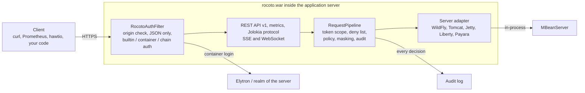

# Rocoto

[](https://github.com/chardonnay/rocoto/actions/workflows/ci.yml)
[](LICENSE)


**A secure, app-server-native JMX management gateway with observability built in.**

Rocoto is a small WAR you deploy into your Java application server – WildFly / JBoss EAP, Tomcat,
Payara. It exposes the server's JMX MBeans over an authenticated JSON/HTTP API, exports metrics
for Prometheus and OpenTelemetry, streams changes, and still speaks the Jolokia protocol for the
tools you already have. It is an alternative to [Jolokia](https://jolokia.org), built only for
application servers and with security as the default, not an option.

```bash
curl -u ada https://appserver:8443/rocoto/api/v1/mbeans/java.lang%3Atype%3DMemory/attributes/HeapMemoryUsage
```

```json
{"mbean":"java.lang:type=Memory","attribute":"HeapMemoryUsage",
 "value":{"committed":536870912,"init":268435456,"max":4294967296,"used":187904816}}
```

## Why Rocoto?

| | Jolokia | Rocoto |
|---|---|---|
| Authentication | optional, off by default | **always required** – no anonymous mode exists |
| Write / exec | allowed unless restricted | **denied unless an allow rule names it** |
| Dangerous MBeans (logback `reloadByURL`, `DiagnosticCommand`, MLet, ...) | reachable | **built-in deny list that cannot be overridden** |
| Proxy mode (JSR-160 targets chosen by the client) | yes (source of CVE-2018-1000130) | **does not exist** |
| Users, roles, audit trail | network + MBean restrictions only | **RBAC per MBean / attribute / operation, JSON audit log** |
| Secrets in attribute values | returned | **masked on the server** |
| Prometheus / OpenTelemetry | external exporters | **`/metrics` and OTLP push built in** |
| Push | pull + SSE for notifications | **SSE and WebSocket for attributes and notifications** |
| API description | none | **OpenAPI 3 + JSON Schema per MBean** |
| 64-bit numbers | plain JSON numbers (precision loss beyond 2^53 in JS clients) | **type-faithful JSON** (large values as strings) |
| App server knowledge | generic | **adapters + one normalized view of datasources, pools, deployments, sessions** |
| CSRF / CORS | permissive defaults | **cross-origin denied, JSON-only bodies** |

## Features

- **Secure by default** – starts read-only, TLS-only credentials, fails closed on configuration errors.
- **Two ways to authenticate, always both available**
  - *container*: the application server's security – Elytron on WildFly / JBoss EAP
    (BASIC, CLIENT_CERT, OIDC bearer tokens), Tomcat and Payara realms;
  - *built-in*: Rocoto's own HTTP Basic (PBKDF2), scoped API tokens, client certificates with
    OCSP/CRL revocation checking, and JWT (RS/ES, JWKS) – implemented with JDK crypto only;
  - *chain*: both at once.
- **Policy, masking, audit** – roles per MBean/attribute/operation, secrets replaced by `********`,
  every write, exec, denial and failed login recorded as a JSON line.
- **Observability** – Prometheus/OpenMetrics endpoint and OTLP/HTTP push with ready-made mapping
  profiles for the JVM, Tomcat, WildFly and Payara; write your own rules in YAML.
- **Server adapters** – `GET /api/v1/resources/datasources` looks the same on every server.
- **Streaming** – subscribe to attributes (on change, thresholds) and JMX notifications over SSE
  or WebSocket; the policy is re-checked on every poll.
- **REST + OpenAPI** – resource style and RPC style, bulk requests, JSON Schema per MBean.
- **Jolokia compatible** – `/jolokia` speaks protocol 7.x for the Jolokia clients, hawtio and
  Telegraf, behind the same security pipeline; verified with the unmodified Jolokia Java client.
- **TLS & OCSP** – recipes to enable OCSP stapling on the server connector, a watchdog that
  reports missing stapling and expiring certificates, `rocoto-tools tls check host:port`.
- **No baggage** – one runtime dependency (SnakeYAML), own JSON reader/writer, no reflection on
  arbitrary beans, no remote JMX connector, no open JMX port.

## How it works



Every request – native API, metrics scrape, Jolokia client, stream poll – takes this one path.
There is no way around the pipeline.

## Supported servers

| Server | Version | Container auth | Status |
|---|---|---|---|
| WildFly / JBoss EAP | 27+ / 8 (Jakarta EE 10) | Elytron | supported, CI smoke test on a real WildFly |
| Apache Tomcat | 10.1 (all of 10.1.0 - 10.1.60 tested), 11.0; 10.0 best effort | Realm | supported, integration tests on embedded Tomcat, CI runs real Tomcat 10.0.27, 10.1.0, 10.1.20 and 10.1.x latest |
| Apache TomEE | 10 (Jakarta EE 10) | Realm | supported through the Tomcat adapter, CI smoke test on a real TomEE (including `tomee.xml` data sources) |
| Eclipse Jetty | 12.0 / 12.1 (EE10) | LoginService | supported, CI smoke test on a real Jetty (needs Jetty's `jmx` module for the normalized view) |
| Undertow (core), Netty | Undertow 2.3, Netty 4.1 | – (built-in only) | supported without a servlet container: handler for your own server, standalone jar, Java agent; SSE only, no WebSocket |
| Payara / GlassFish | 6+ | Realm | experimental, smoke-tested on Payara 6 / 7 and GlassFish 7 / 8 (normalized view needs AMX monitoring; GlassFish 7: use the POST endpoints) |
| Open Liberty / WebSphere Liberty | 26.0.0.9 (Jakarta EE 10 features) | User registry | supported, CI smoke test on a real Open Liberty (needs `monitor-1.0` for the normalized view) |
| WebSphere traditional, WebLogic | – | – | planned |

**CPU architectures:** `rocoto.war` and `rocoto-tools.jar` are plain Java bytecode without native
libraries. The same file runs on arm64 (Apple Silicon, AWS Graviton, ...) and amd64 (Intel/AMD);
`ci/arch/arch-test.sh` runs the one WAR on both, and CI builds and tests natively on Linux amd64,
Linux arm64, Apple Silicon and Windows ([notes for Windows](docs/guide/02-installation.md#windows)).

## Quick start

```bash
# 1. download the compiled rocoto-<version>.war and rocoto-tools-<version>.jar from the GitHub
#    releases page (one file for all CPU architectures) and save the WAR as rocoto.war -
#    or build it yourself (JDK 17+):
mvn verify

# 2. deploy
cp rocoto-war/target/rocoto.war $CATALINA_BASE/webapps/          # Tomcat
# cp rocoto-war/target/rocoto.war $JBOSS_HOME/standalone/deployments/   # WildFly

# 3. create a user and an API token (the token is shown once)
java -jar rocoto-tools/target/rocoto-tools.jar user add ada --roles rocoto-admin \
     --file $CATALINA_BASE/conf/rocoto-users.yaml
java -jar rocoto-tools/target/rocoto-tools.jar token create prometheus --roles rocoto-reader \
     --mbeans "java.lang:*;Catalina:*" --file $CATALINA_BASE/conf/rocoto-users.yaml

# 4. use it (credentials are only accepted over TLS)
curl -u ada https://localhost:8443/rocoto/api/v1/server
curl -u ada https://localhost:8443/rocoto/api/v1/resources/threadpools
curl -H "Authorization: Bearer rct_prometheus_..." https://localhost:8443/rocoto/metrics
```

No `rocoto.yaml` is needed for this: the defaults are built-in authentication and a read-only
policy. To allow an operation, say so explicitly:

```yaml
# conf/rocoto.yaml
policy:
  rules:
    - roles: [rocoto-operator, rocoto-admin]
      allow: [exec]
      mbean: "java.lang:type=Memory"
      operations: [gc]
```

To let WildFly's Elytron authenticate instead: `auth: { mode: container }` – see the guide.

## Documentation

| | |
|---|---|
| [Guide](docs/guide/README.md) | architecture, installation, **[authentication](docs/guide/03-authentication.md)**, **[how Rocoto connects to JMX on JBoss and Tomcat](docs/guide/04-jmx-connection.md)**, policy, metrics, streaming, REST API, Jolokia migration, **[WildFly & Elytron](docs/guide/10-wildfly-elytron.md)**, hardening, troubleshooting, **[TLS & OCSP stapling](docs/guide/13-tls-and-ocsp.md)** – with diagrams |
| [Examples](docs/examples/README.md) | cookbook for every scenario, backed by runnable projects in [`examples/`](examples/README.md) |
| [Configuration reference](docs/reference/configuration.md) | every key of `rocoto.yaml` and `rocoto-users.yaml` |
| [OpenAPI](rocoto-api/src/main/resources/io/rocoto/api/openapi.json) | also served at `/rocoto/api/v1/openapi.json` |

## Coming from Jolokia?

Point your client at `https://host/rocoto/jolokia`, give it credentials, and convert your policy:

```bash
java -jar rocoto-tools.jar policy convert jolokia-access.xml
```

Differences and a checklist: [Jolokia compatibility and migration](docs/guide/09-jolokia-compat-and-migration.md).

## Project

- [Contributing](CONTRIBUTING.md) · [Security policy](SECURITY.md) · [Code of conduct](CODE_OF_CONDUCT.md)
- License: [MIT](LICENSE)

The name: *rocoto* is a chili pepper that looks like a harmless little apple.
