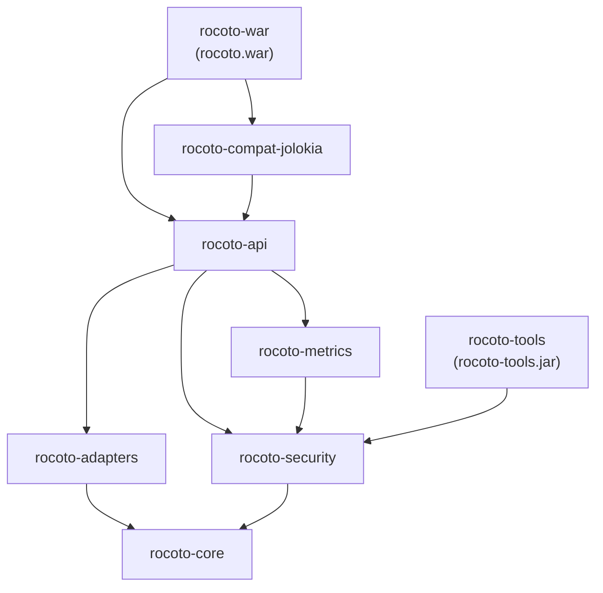
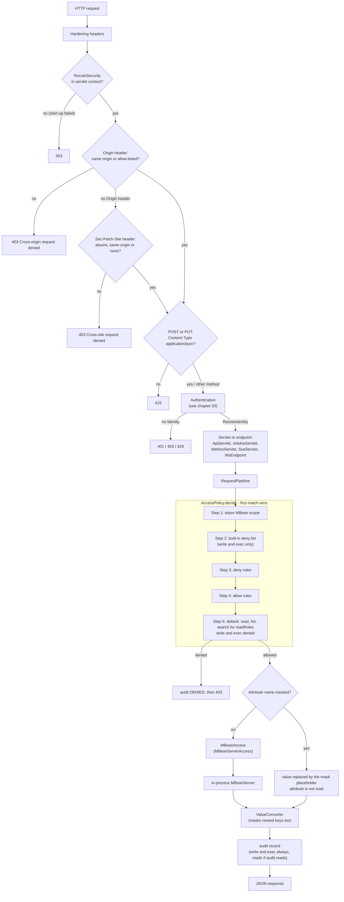

# 01 - Architecture

Rocoto is a single WAR that runs inside the application server it manages. It reads and changes
MBeans of the local JVM on behalf of authenticated HTTP clients. This chapter shows which parts
it consists of, which way a request takes and which design decisions keep the attack surface small.

## Modules

| Module | Responsibility |
|--------|----------------|
| `rocoto-core` | Configuration loading (`ConfigLoader`, `Config`), JMX access (`MBeanAccess`, `MBeanServerAccess`, `MBeanMetadata`), value conversion (`ValueConverter`, `ArgumentConverter`), JSON reader and writer (`JsonParser`, `JsonWriter`), the request vocabulary (`Operation`, `Target`). |
| `rocoto-security` | Authentication (`BuiltinAuthenticator`, `UserStore`, `ApiTokens`, `JwtVerifier`, `Lockout`), the servlet filter (`RocotoAuthFilter`), policy (`AccessPolicy`, `Rule`, `Denylist`, `ValueMasker`), audit (`AuditLogger`), TLS helpers (`RevocationChecker`, `OutboundTls`, `TlsProbe`) and the `RequestPipeline` that ties them together. |
| `rocoto-adapters` | Knowledge about server families: `WildFlyAdapter`, `TomcatAdapter`, `PayaraAdapter`, `GenericAdapter`. Detection, the normalized resource view and identity propagation. Adapters are found with `java.util.ServiceLoader`. |
| `rocoto-metrics` | Mapping rules from MBean attributes to metrics, bundled profiles, Prometheus/OpenMetrics text writer, OTLP/HTTP exporter. |
| `rocoto-api` | Start-up (`RocotoBootstrap`, `RocotoRuntime`), REST API (`ApiServlet`), `/metrics` (`MetricsServlet`), streaming (`SseServlet`, `WsEndpoint`, `SubscriptionManager`), the TLS self probe. |
| `rocoto-compat-jolokia` | `JolokiaServlet`: the Jolokia protocol on `/jolokia/*`, backed by the same pipeline. |
| `rocoto-war` | Packaging only: `web.xml`, `jboss-web.xml`, `jboss-deployment-structure.xml`, `glassfish-web.xml`. Produces `rocoto.war`. |
| `rocoto-tools` | Command line tool (`rocoto-tools.jar`): manage users and tokens, hash passwords, convert a Jolokia policy, check a TLS listener. Not part of the WAR. |

The arrows point from a module to the modules it depends on:



Third-party code inside the WAR is limited to SnakeYAML, used with `SafeConstructor` (only maps,
lists and scalars; no Java types from YAML tags). Cryptography, HTTP clients, JSON and JWT handling
use JDK classes only. The servlet and WebSocket APIs are provided by the application server.

## The request path

Every request, whatever endpoint it addresses, takes the same path.



Details worth knowing:

- **Hardening headers** are set first, on every response - including error responses and the
  `503` of a failed start-up: `X-Content-Type-Options: nosniff`, `X-Frame-Options: DENY`,
  `Content-Security-Policy: default-src 'none'; frame-ancestors 'none'`, `Cache-Control: no-store`,
  `Referrer-Policy: no-referrer`.
- **Origin check.** A request with an `Origin` header comes from a browser. It is rejected with
  `403` unless the origin equals the server's own origin or is listed in `cors.allowedOrigins`.
  There is no wildcard; `'*'` in the configuration aborts start-up.
- **Fetch metadata check.** Browsers send no `Origin` header for plain cross-site `GET`s
  (``, `<script>`, a navigation), but they do attach cached Basic credentials. A request
  without `Origin` whose `Sec-Fetch-Site` header is anything other than `same-origin` or `none`
  is therefore rejected with `403 Cross-site request denied`. Non-browser clients do not send
  the header and are not affected.
- **JSON-only bodies.** `POST` and `PUT` must carry `Content-Type: application/json`, otherwise the
  answer is `415`. HTML forms cannot send that type, which blocks classic cross-site form posts.
- **The only anonymous path** is `GET /api/v1/health/live`, and only if `health.allowAnonymous` is
  `true`. It returns `{"status":"UP"}` and nothing else.
- **One pipeline.** `RequestPipeline` is the only class that touches `MBeanAccess`. REST, Jolokia
  compatibility, metrics, streaming, the normalized resource view and the OTLP exporter all go
  through it, so policy, masking and audit cannot be bypassed by choosing a different endpoint.
- **Generic denial message.** A policy denial is answered with `403` and the text `Access denied by
  policy`. The precise reason (for example `built-in deny list: ...`) is written to the audit log
  only, so the policy cannot be probed from outside.
- **Errors never contain stack traces.** Unexpected failures are logged on the server and answered
  with `500` and `Internal error`.

The WebSocket endpoint is reached through the same filter: the upgrade request is an ordinary HTTP
request. The filter wraps the request so that `getUserPrincipal()` returns a `RocotoPrincipal`,
which carries the identity across the upgrade. A WebSocket session without such a principal is
closed immediately.

## Start-up: Rocoto fails closed

`RocotoBootstrap` (a `ServletContextListener`) builds one `RocotoRuntime` per deployment:

1. `ConfigLoader` locates `rocoto.yaml` (see the
   [configuration reference](../reference/configuration.md)). Without any file, secure defaults
   apply. If `rocoto.config` or `ROCOTO_CONFIG` names a file that does not exist, start-up fails.
2. `RocotoSecurity.fromConfig` builds authentication, policy, masking and audit.
3. `ServerAdapters.select` picks the server adapter, which decides which MBeanServers are exposed.
4. Metrics, OTLP exporter, subscription manager and the TLS self probe are started.
5. Only after all of this succeeded are the runtime and the security object published in the
   servlet context, and the WebSocket endpoint is registered (if `stream.websocket` is `true` and
   the server offers a WebSocket container).

If any step throws - an unknown `auth.mode`, an invalid policy rule, an unwritable audit file, a
non-HTTPS JWKS URL - nothing is published. The filter then finds no `RocotoSecurity` and answers
**every** request with `503` and `Rocoto is not initialised; see server log`. A broken
configuration never results in an open or half-configured instance.

```bash
# What a client sees after a configuration error
curl -i https://server:8443/rocoto/api/v1/server
# HTTP/1.1 503
# {"status":503,"error":"Rocoto is not initialised; see server log"}
```

The user store behaves differently on purpose: it is re-read while the server runs, and a syntax
error in `rocoto-users.yaml` keeps the last good content instead of locking everybody out or
letting everybody in.

## Design principles

**No proxy mode.** Rocoto only talks to MBeanServers inside its own JVM. There is no JSR-160
connector client and no way for a client to name a target. The Jolokia compatibility endpoint
answers requests that contain a `target` with status `403`. A management endpoint that opens
connections to client-chosen URLs is a server-side request forgery and JNDI injection vector;
Rocoto does not have the feature at all.

**No reflection on arbitrary beans.** `ValueConverter` understands a fixed set of types: strings,
numbers, booleans, characters, `byte[]`, `ObjectName`, enums, dates, `CompositeData`,
`TabularData`, maps, collections and arrays. Everything else is rendered with `toString()`.
Rocoto never walks the getters of an unknown object, which would leak internals.

**A closed set of argument types.** `ArgumentConverter` converts JSON into the types an attribute
or operation declares: primitives and their wrappers, `String`, `BigInteger`, `BigDecimal`,
`Date`, `ObjectName`, `byte[]` (base64), lists, sets, maps, arrays of these, and JMX open types.
A parameter of any other type is rejected with `400`. Rocoto never instantiates a class named by
the client, so `write` and `exec` cannot be used as a deserialization gadget.

**Own JSON reader and writer.** `JsonParser` and `JsonWriter` are small, have no polymorphic
typing and no data binding. The writer renders anything unexpected as a string, escapes `<`, `>`
and `&` so that a response mistakenly rendered by a browser cannot inject script, and writes
`NaN` and infinities as strings instead of producing invalid JSON.

**Secure by default.** Without configuration: built-in authentication, credentials only over TLS,
read-only policy, an empty user store (nobody can log in until a user or token is created).
Mutating operations always need an explicit allow rule.

**Bounded resources.** Request bodies are limited to 1 MiB (in characters), bulk requests to
`api.maxBulkRequests`, pattern reads to `api.maxPatternMBeans` MBeans, subscriptions globally and
per user and in their duration (`stream.maxDurationSeconds`), polling intervals have a lower
bound, and converted values are limited in depth (16) and collection size (10,000 elements).

Next: [02 - Installation](02-installation.md)
