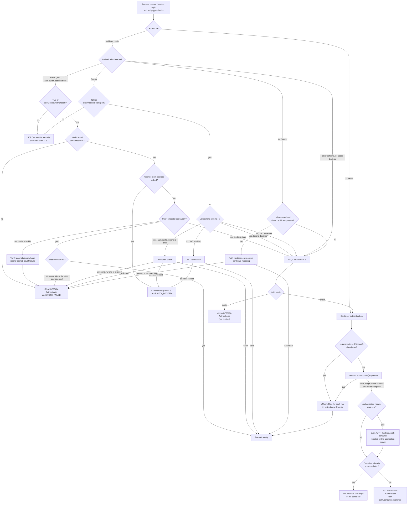
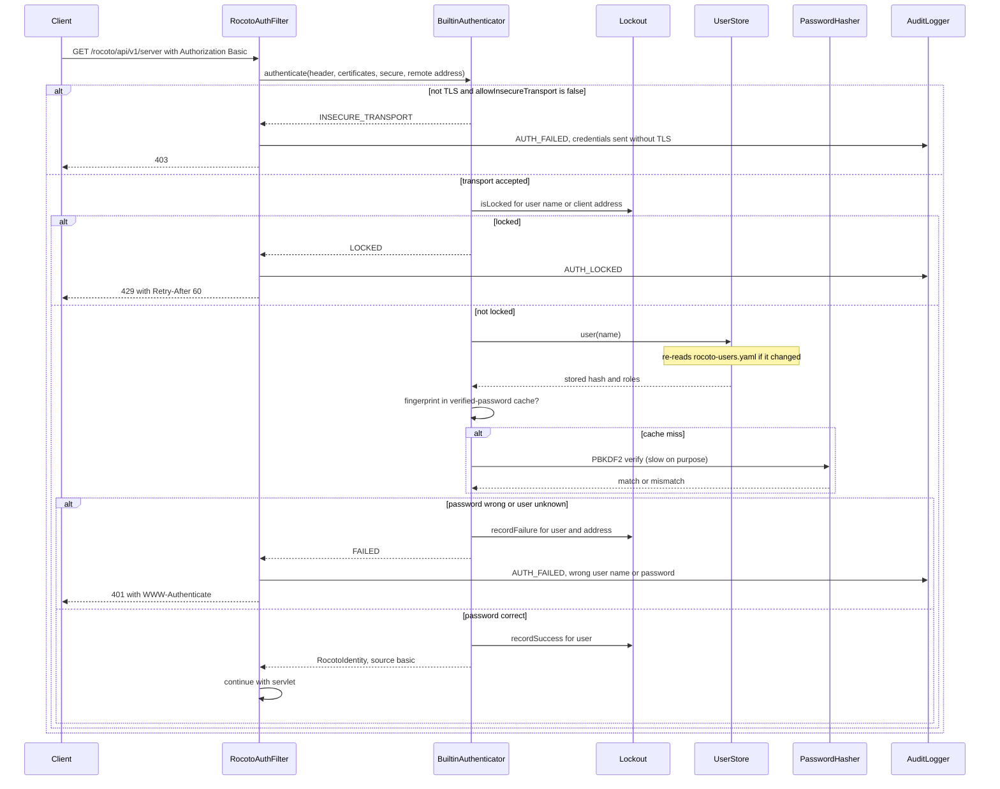
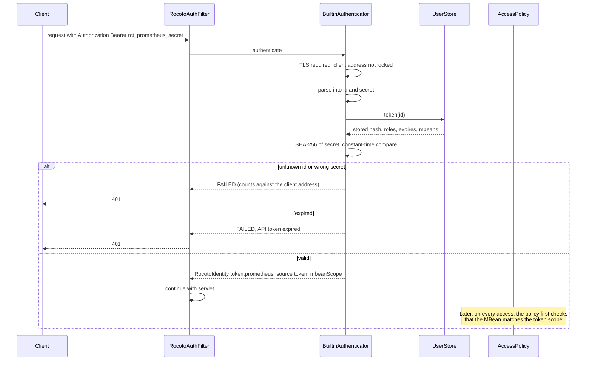
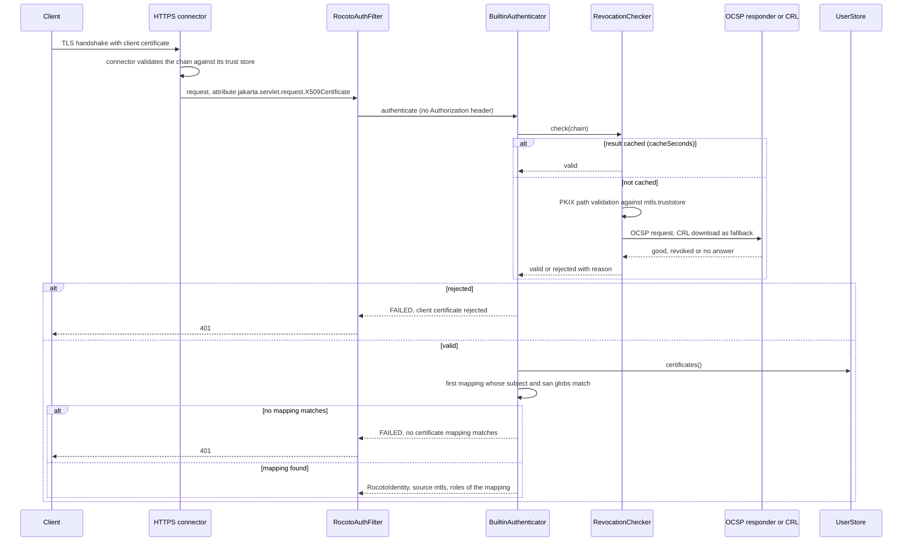
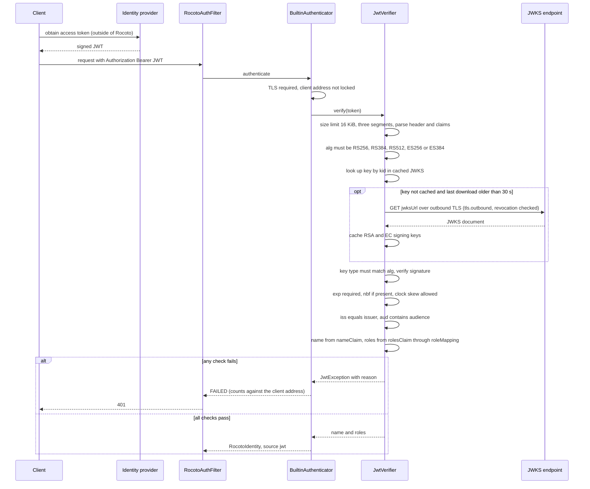
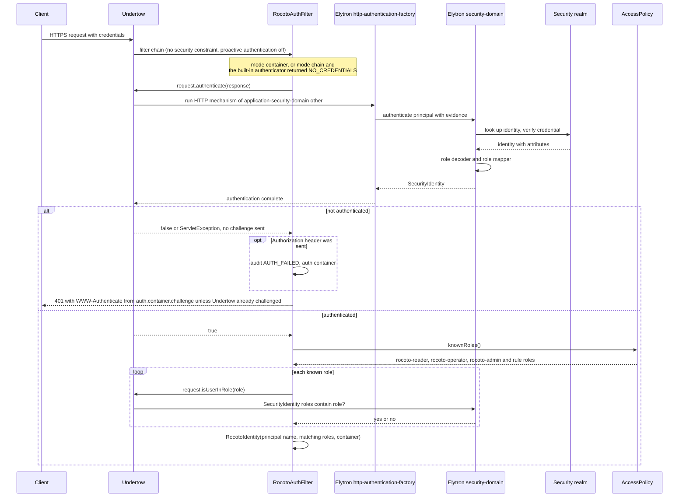
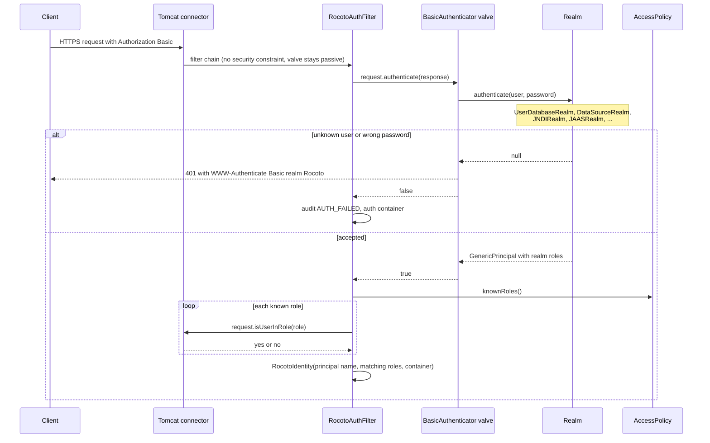

# 03 - Authentication

Every request must be authenticated before it reaches an endpoint. Rocoto can authenticate callers
itself (HTTP Basic, API tokens, client certificates, JWT), leave authentication to the application
server (Elytron on WildFly, a realm on Tomcat or Payara), or combine both. Whatever mechanism is
used, the result is the same object - a `RocotoIdentity` - and everything after authentication
(policy, masking, audit) is independent of how the caller logged in.

All configuration keys mentioned here are documented in the
[configuration reference](../reference/configuration.md).

## The three modes

```yaml
auth:
  mode: builtin     # builtin | container | chain
```

| `auth.mode` | Who authenticates | Typical use |
|-------------|-------------------|-------------|
| `builtin` (default) | Rocoto only: `rocoto-users.yaml`, client certificates, JWT | The same set-up on every server; monitoring tokens; no dependency on server security configuration |
| `container` | The application server only, through `HttpServletRequest.authenticate()` | Users and roles already live in Elytron, LDAP, a Tomcat realm, ... |
| `chain` | Rocoto first; requests without credentials Rocoto recognizes are handed to the application server | Human users from the server's realm plus Rocoto API tokens for machines |

In `container` mode the built-in authenticator is not even created: `rocoto-users.yaml` is not
read and API tokens do not work.

## How the filter decides

`RocotoAuthFilter.authenticate` and `BuiltinAuthenticator.authenticate`, exactly as implemented:



Consequences that are easy to miss:

- **`401` vs. `403` vs. `429`.** `401` means "no or wrong credentials" and carries
  `WWW-Authenticate` challenges for what is enabled (`Basic realm="Rocoto", charset="UTF-8"`
  and/or `Bearer realm="Rocoto"`). In `container` and `chain` mode a `401` written by Rocoto
  additionally carries the value of `auth.container.challenge` (default
  `Basic realm="Rocoto", charset="UTF-8"`), unless the application server has already set a
  `WWW-Authenticate` header of its own. `403 Credentials are only accepted over TLS` means the
  credentials were not even looked at. `429` means the user or the client address is locked.
- **The container does not always challenge.** Tomcat writes its own `401` when
  `request.authenticate()` fails. Undertow (WildFly) instead reports a missing or failed login as
  a `ServletException` without sending a challenge. Rocoto catches it and answers `401` with a
  `WWW-Authenticate` header itself, so clients such as `curl -u` or a browser behave the same on
  every server. Set `auth.container.challenge` if the Elytron mechanism is not BASIC (for example
  `Bearer realm="Rocoto"`).
- **A client certificate is only evaluated when there is no `Authorization` header.** A request
  that sends both is authenticated by the header.
- **Chain mode defers, it does not fall through on failure.** Only requests for which Rocoto has
  *no opinion* go to the container: no credentials, an unknown authentication scheme, a JWT-style
  bearer token while JWT is disabled, or Basic credentials of a user that is not in
  `rocoto-users.yaml`. A *wrong password* for a user Rocoto knows is a `401` and is never retried
  against the container. Avoid having the same user name in both stores.
- In chain mode a `rct_...` bearer token that is wrong is a `401`; it is not passed on.
- Authentication failures are audited with `action: LOGIN` and the outcome `AUTH_FAILED` or
  `AUTH_LOCKED`. The reason (`wrong user name or password`, `API token expired`,
  `JWT rejected: token expired`, `no certificate mapping matches`, ...) is only in the audit log,
  never in the response.
- Credentials that were presented to the **container** and rejected by it are audited as well:
  outcome `AUTH_FAILED`, `auth: container`, reason `rejected by the application server's security
  domain`. The record carries no user name (`"user":null`) - Rocoto never parses credentials meant for the container.
  A request without an `Authorization` header is answered with `401` and not audited.

## The unified identity

```text
RocotoIdentity(name, roles, source, mbeanScope)
```

| Field | Content |
|-------|---------|
| `name` | Principal name. API tokens are named `token:<id>`. |
| `roles` | Role names, compared literally with the roles in the policy |
| `source` | `basic`, `token`, `mtls`, `jwt`, `container` (or `internal` for the OTLP exporter) |
| `mbeanScope` | Only for API tokens: ObjectName patterns the token is restricted to |

The filter stores the identity as a request attribute and additionally wraps the request so that
`getUserPrincipal()`, `getRemoteUser()` and `isUserInRole()` answer from the Rocoto identity.
`GET /api/v1/server` shows the caller as Rocoto sees it:

```bash
curl -s -u ada https://server:8443/rocoto/api/v1/server
# ... "caller": {"name":"ada","roles":["rocoto-admin"],"authenticatedBy":"basic"}
```

### Standard roles

| Role | Meaning with the default policy |
|------|---------------------------------|
| `rocoto-reader` | read, list, search |
| `rocoto-operator` | the same as reader, until an allow rule grants more |
| `rocoto-admin` | the same as reader, until an allow rule grants more |

The names carry no built-in privileges beyond read access (`policy.readRoles`). Write and exec
always need an explicit allow rule, also for `rocoto-admin`; see
[05 - Authorization policy](05-authorization-policy.md). You can use your own role names; they
only have to match between the identity source and the policy.

## Built-in: HTTP Basic

Users live in `rocoto-users.yaml` with a PBKDF2-HMAC-SHA256 hash
(`pbkdf2-sha256$<iterations>$<salt>$<hash>`, 600,000 iterations when created by `rocoto-tools`;
hashes with fewer than 100,000 iterations are rejected as invalid).

```bash
java -jar rocoto-tools.jar user add rita --roles rocoto-reader --file rocoto-users.yaml
curl -s -u rita https://server:8443/rocoto/api/v1/mbeans?pattern=java.lang:*
```



- **Lockout.** `auth.builtin.lockout`: after `maxAttempts` (default 5) failures within
  `windowSeconds` (300) the user name is locked for `lockSeconds` (900), whether or not the user
  exists. Failures are also counted per client address with the higher threshold
  `addressMaxAttempts` (50). Behind a reverse proxy all clients share one address - raise the
  value or set it to `0` to disable the per-address lockout. A successful login clears the
  counter of the user. Lockout state lives in memory and is lost on restart.
- **Verified-password cache.** PBKDF2 is deliberately slow, which would make every polled request
  expensive. After a successful verification Rocoto remembers, for five minutes and in memory
  only, a SHA-256 fingerprint over a per-process random salt, the stored hash and the password.
  Changing the password changes the stored hash and thereby invalidates the entry. Removing a
  user or changing roles takes effect immediately, because the user record is looked up first on
  every request.
- **Unknown users** are verified against a dummy hash so that "unknown user" and "wrong password"
  take the same time and return the same response.
- `auth.builtin.basic: false` disables the mechanism.

## Built-in: API tokens

A token has the form `rct_<id>_<secret>`; the secret carries 256 bits of randomness. Only
`sha256$<hash>` of the secret is stored.

```bash
java -jar rocoto-tools.jar token create prometheus --roles rocoto-reader --days 90 \
  --mbeans "java.lang:*;Catalina:*" --file rocoto-users.yaml

curl -s -H "Authorization: Bearer $TOKEN" https://server:8443/rocoto/metrics
```



### MBean scopes

`mbeans:` restricts a token to MBeans matching at least one ObjectName pattern, *whatever its
roles say*. The scope is the first thing the policy evaluates. A scope only narrows access; it
never grants anything the roles would not allow.

```yaml
tokens:
  - id: prometheus
    hash: "sha256$..."
    roles: [rocoto-reader]
    expires: "2027-01-01T00:00:00Z"
    mbeans: ["java.lang:*", "Catalina:*"]
```

With this token, `GET /metrics` silently contains only samples from these domains, a search
returns only these MBeans, and a direct read of anything else is a `403`.

Revoke a token with `rocoto-tools token revoke <id>`; the running server notices within seconds.
`auth.builtin.tokens: false` disables the mechanism.

## Built-in: client certificates (mTLS)

The TLS handshake is performed by the application server's HTTPS connector, which must be
configured to request (or require) a client certificate and to trust the issuing CA. Rocoto reads
the verified chain from the request attribute `jakarta.servlet.request.X509Certificate`, validates
it again against its own trust anchors including revocation, and maps it to roles.

```yaml
auth:
  builtin:
    mtls:
      enabled: true
      revocation: hard-fail            # off | soft-fail | hard-fail
      truststore: /etc/rocoto/clients-ca.p12
      truststorePassword: ${env:ROCOTO_TRUSTSTORE_PASSWORD}
```

```yaml
# rocoto-users.yaml
certificates:
  - subject: "CN=ops-*,OU=Operations,O=Example,C=DE"   # glob over the RFC 2253 subject DN
    san: "*.ops.example.com"                           # optional glob over SAN entries
    name: ops                                          # optional, default: the CN
    roles: [rocoto-operator]
```

```bash
curl -s --cert ops-client.pem --key ops-client.key --cacert ca.pem \
  https://server:8443/rocoto/api/v1/server
```



- `revocation: hard-fail` (default) rejects revoked certificates **and** certificates whose status
  cannot be determined (responder unreachable). `soft-fail` tolerates an unreachable responder.
  `off` validates the path only.
- Only positive results are cached, for `cacheSeconds` (default 300), keyed by issuer and serial
  number.
- `ocspResponder` overrides the responder URL from the certificate.
- A mapping needs `subject` or `san` (or both; then both must match). Globs are case-insensitive.
  Mappings are evaluated in file order; the first match wins. A valid certificate without a
  matching mapping is rejected - trust in the CA alone grants nothing.
- In chain mode a presented but rejected certificate ends in `401`; the request is not handed to
  the container.

More on revocation and stapling: [13 - TLS and OCSP](13-tls-and-ocsp.md).

## Built-in: JWT

Rocoto validates signed JWTs from an OpenID Connect provider as bearer tokens. It is a resource
server only; it never redirects to a login page.

```yaml
auth:
  builtin:
    jwt:
      enabled: true
      issuer: https://idp.example/realms/ops
      audience: rocoto
      jwksUrl: https://idp.example/realms/ops/protocol/openid-connect/certs
      rolesClaim: realm_access.roles        # dotted paths descend into objects
      roleMapping: { ops-admin: rocoto-admin, ops-viewer: rocoto-reader }
```

```bash
curl -s -H "Authorization: Bearer $ACCESS_TOKEN" https://server:8443/rocoto/api/v1/server
```



- `issuer` and `audience` are required; exactly one of `jwksUrl` and `publicKey` (PEM, RSA or EC)
  must be set.
- `alg: none` and all HMAC algorithms are rejected. The key type must match the algorithm, which
  defeats algorithm-confusion attacks.
- The JWKS is downloaded lazily - on the first token and whenever a token names an unknown `kid` -
  but not more often than every 30 seconds. Redirects are not followed, the document is limited
  to 1 MB, and the connection uses `tls.outbound` (trust store, revocation checking, optional
  `requireStapling`). `jwksUrl` must be `https` unless `auth.allowInsecureTransport` is set.
- Tokens without `kid` are accepted only if the JWKS contains exactly one signing key.
- Roles: `rolesClaim` may be an array or a space- or comma-separated string. If `roleMapping` is
  empty (the default), the values are used as they are. If `roleMapping` is **not** empty, only
  mapped values count and every unmapped value is dropped - a role that merely happens to be
  called `rocoto-admin` at the identity provider then grants nothing. To keep a role under its
  own name, map it onto itself (`rocoto-reader: rocoto-reader`).
- A bearer token that starts with `rct_` is always treated as an API token, never as a JWT.

## Container authentication

In `container` and `chain` mode the filter asks the application server to authenticate by calling
`HttpServletRequest.authenticate(response)`. The server runs whatever mechanism is configured for
the deployment. If the request carries no valid credentials, the server either writes its own
challenge (Tomcat) or reports the failure without one (Undertow/WildFly); in the second case
Rocoto answers `401` with `auth.container.challenge`. After a successful login Rocoto
asks `isUserInRole(role)` for every role in `policy.knownRoles()` - the `readRoles`, the
three standard roles and every role named in a policy rule - and builds the identity from the
answers. The source is `container`.

A user the server authenticates but who has none of these roles gets an identity with an empty
role set: searches return nothing and reads are answered with `403`.

### Why `web.xml` has no security constraints

Declarative `<security-constraint>` elements would make the container authenticate *before* the
filter runs, which makes built-in authentication (and therefore `builtin` and `chain` mode)
impossible: a request with an API token would be rejected by the container. Rocoto therefore
ships without constraints and enforces authentication programmatically in the filter, which is
mapped to `/*`. Endpoints additionally refuse to work without an identity, so a mis-mapped filter
results in `401`, never in open access.

`web.xml` does declare what container mode needs: `<login-config>` with `BASIC` as the mechanism
(on WildFly the mechanisms of an Elytron `http-authentication-factory` replace it when the
`application-security-domain` is configured with `override-deployment-config=true`) and the three
standard roles as `<security-role>`. If you use additional role names in
container mode, note that some servers only answer `isUserInRole` for declared roles.

### WildFly / JBoss EAP (Elytron)

`jboss-web.xml` maps the deployment to the application security domain `other`, which every
default WildFly configuration defines. The Undertow subsystem maps it to an Elytron security
domain (then the `<login-config>` of `web.xml` selects the mechanism) or to an
`http-authentication-factory` (which can replace the mechanism: BASIC, CLIENT_CERT,
BEARER_TOKEN, ...). The security domain determines the realm and the role decoding.

`jboss-web.xml` also sets `<proactive-authentication>false</proactive-authentication>`. With
Undertow's default (proactive authentication on), Elytron evaluates an `Authorization: Basic`
header **before** Rocoto's filter runs and answers `401` for users that exist only in Rocoto's
own user store - `chain` and `builtin` mode would not work for Basic users. With the element set
to `false`, nothing is authenticated until Rocoto calls `request.authenticate()` itself. This
was found and is verified by the WildFly smoke test in CI. If you replace `jboss-web.xml` (for
example with a deployment overlay), keep this element.



With the default configuration, `other` is backed by Elytron's `ApplicationDomain` and the
`ApplicationRealm`. A user is created like this; the group becomes the Rocoto role:

```bash
$JBOSS_HOME/bin/add-user.sh -a -u carl -g rocoto-admin
```

This path - `add-user.sh -a -g rocoto-admin`, the unchanged `other` domain, `auth.mode: chain`,
login with HTTP Basic, `"authenticatedBy": "container"` and `"roles": ["rocoto-admin"]` in
`GET /api/v1/server` - is exercised by the WildFly smoke test in CI (`ci/wildfly/`).

```yaml
# standalone/configuration/rocoto.yaml
auth:
  mode: container
```

On WildFly, authentication by the container has a second effect: the Elytron `SecurityIdentity`
of the caller is the one WildFly's own management RBAC sees when Rocoto touches `jboss.as:*`
MBeans. See [04 - The JMX connection](04-jmx-connection.md) for what that means, and
[10 - WildFly and Elytron](10-wildfly-elytron.md) for complete Elytron configurations (LDAP,
client certificates, bearer tokens, a dedicated security domain instead of `other`).

### Tomcat realms

Tomcat installs its authenticator valve because `web.xml` contains a `<login-config>`. The valve
does nothing until the filter asks for authentication.



Example with the default `UserDatabaseRealm` (`conf/tomcat-users.xml`):

```xml
<role rolename="rocoto-admin"/>
<user username="carl" password="..." roles="rocoto-admin"/>
```

Use a realm with hashed credentials (`CredentialHandler`) in production, and wrap it in Tomcat's
`LockOutRealm` - Rocoto's own lockout only covers built-in authentication.

### Payara

`glassfish-web.xml` maps realm groups named `rocoto-reader`, `rocoto-operator` and `rocoto-admin`
to the roles of the same name. Create users in the realm of your choice and put them into these
groups.

## User store hot reload

`rocoto-users.yaml` is checked for modification at most every two seconds, on access. When the
modification time changed, the file is parsed again:

- Valid content replaces the previous content atomically. Rotating a password, revoking a token or
  changing roles needs no redeploy and no restart.
- Invalid content (YAML error, malformed hash, bad ObjectName, bad date) is logged as `SEVERE` and
  the **previous content stays active**. A typo can neither lock everybody out nor let anybody in.
- If the file is missing, the store is empty, a warning is logged and
  `GET /api/v1/health` reports `built-in user store is empty`.
- Rocoto warns if the file is readable or writable by other OS users (`chmod 600`).

`rocoto.yaml` itself is read once at start-up; changing it requires a redeploy or restart.

## Secure defaults at a glance

| Default | Effect |
|---------|--------|
| `auth.mode: builtin`, empty user store | Nobody can log in until a user or token is created |
| `allowInsecureTransport: false` | Basic and bearer credentials over plain HTTP are answered with `403` |
| PBKDF2 with 600,000 iterations, tokens stored as SHA-256 | The user store contains no recoverable secrets |
| Lockout per user and per address | Brute force is slowed down and audited |
| `mtls.revocation: hard-fail` | A certificate with unknown revocation status is rejected |
| JWT: asymmetric algorithms only, `iss`, `aud`, `exp` mandatory | No `alg: none`, no key confusion, no unbounded tokens |
| `health.allowAnonymous: false` | Even the liveness probe requires credentials |
| Generic error messages | Reasons for failed logins and denials are only in the audit log |

Next: [04 - The JMX connection](04-jmx-connection.md)
