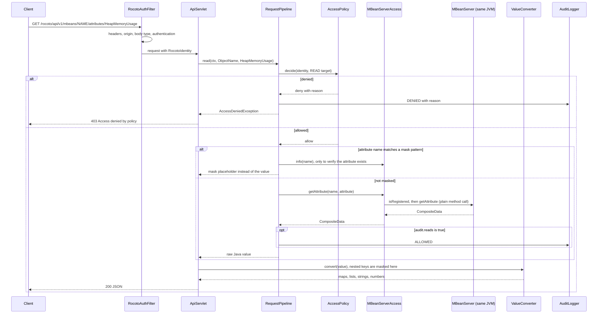
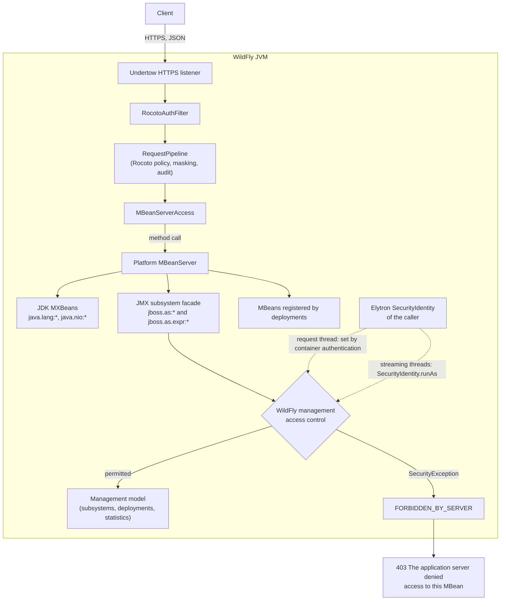
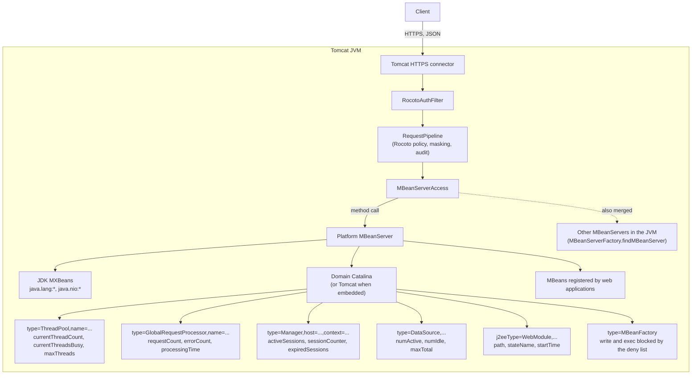

# 04 - The JMX connection

"How does Rocoto connect to JMX?" The short answer: it does not connect at all. Rocoto runs inside
the JVM of the application server and calls the MBeanServer objects of that JVM directly, with
plain Java method calls. This chapter makes that path transparent, shows what it looks like on
WildFly and Tomcat, and explains how values are turned into JSON without losing information.

## In-process only

At start-up `RocotoRuntime` does two things:

1. It obtains the platform MBeanServer with `ManagementFactory.getPlatformMBeanServer()`.
2. It asks the selected server adapter which MBeanServers to expose
   (`ServerAdapter.mbeanServers(platform)`) and wraps the answer in one `MBeanServerAccess`, which
   presents them as a single merged view.

| Adapter | MBeanServers exposed |
|---------|----------------------|
| `wildfly` | the platform MBeanServer only |
| `tomcat`, `payara`, `generic` | the platform MBeanServer plus every other MBeanServer found in the JVM with `MBeanServerFactory.findMBeanServer(null)` |

That is the complete list of JMX sources. In particular:

- **No JSR-160 / RMI connector.** Rocoto contains no `JMXConnectorFactory` call and needs no
  `com.sun.management.jmxremote.*` system properties. If you only enabled remote JMX for
  monitoring, you can switch it off.
- **No open JMX port.** The only listener involved is the HTTPS listener of the application
  server, which exists anyway. Nothing new has to be opened in a firewall.
- **No client-chosen targets.** A request cannot name a JMX service URL. There is no proxy mode;
  the Jolokia compatibility endpoint answers requests containing `target` with status `403`.
- **No Java serialization on the wire.** Requests and responses are JSON, produced and parsed by
  Rocoto's own small reader and writer.

Queries run against all exposed MBeanServers and the results are merged. For reads, writes and
operations the first MBeanServer in which the ObjectName is registered is used.

## A read, step by step



Failures of the MBeanServer are classified and mapped to HTTP status codes; stack traces never
leave the server:

| Situation | Status |
|-----------|--------|
| MBean, attribute or operation does not exist | `404` |
| Invalid value, read-only attribute, ambiguous operation, unsupported argument type | `400` |
| Denied by the Rocoto policy | `403` `Access denied by policy` |
| `SecurityException` from the MBeanServer (`FORBIDDEN_BY_SERVER`) | `403` `The application server denied access to this MBean`; a refused read is audited as `DENIED` with the reason `denied by the application server` |
| Any other exception thrown by the MBean | `500` with the exception class and message, no stack trace |

## Adapter detection

Adapters are discovered with `ServiceLoader` and asked in order of priority. The first one whose
`detect` method answers `true` wins.

| Order | Adapter | Detected when |
|-------|---------|---------------|
| 1 | `wildfly` | `jboss.as:management-root=server` is registered, or any `jboss.as:subsystem=*` MBean exists, or the system property `jboss.home.dir` is set |
| 2 | `payara` | the system property `com.sun.aas.instanceRoot` is set, or an `amx-support:*` MBean exists |
| 3 | `tomcat` | an MBean `*:type=Engine` exists; its domain (`Catalina` or `Tomcat`) becomes the adapter's JMX domain |
| 4 | `generic` | always (fallback): plain MBean access, empty normalized view |

Force an adapter with `server.adapter: wildfly | tomcat | payara | generic` in `rocoto.yaml`; an
unknown id aborts start-up. The active adapter is logged (`Rocoto server adapter: tomcat`) and
reported by `GET /api/v1/server` and `GET /api/v1/health`.

The adapter influences four things: which MBeanServers are exposed, the product information in
`/api/v1/server`, the normalized resource view, and which bundled metrics profile `auto` resolves
to. It does **not** restrict which MBeans you can address: every MBean of the exposed MBeanServers
is reachable through the generic API, subject to policy.

## WildFly / JBoss EAP

WildFly's management model (what you see in `jboss-cli.sh`) is not made of MBeans. The **JMX
subsystem** publishes a facade over it in the platform MBeanServer, in two domains:

- `jboss.as` - resolved values (expressions such as `${jboss.bind.address}` are evaluated)
- `jboss.as.expr` - the raw expressions; writable where the model allows it

A management address becomes an ObjectName, and attribute names are converted to camel case:

| Management model | JMX facade |
|------------------|------------|
| `/subsystem=datasources/data-source=ExampleDS/statistics=pool` | `jboss.as:subsystem=datasources,data-source=ExampleDS,statistics=pool` |
| attribute `in-use-count` | attribute `inUseCount` |
| `/subsystem=undertow/server=default-server/http-listener=default` : `request-count` | `jboss.as:subsystem=undertow,server=default-server,http-listener=default` : `requestCount` |



Things to know on WildFly:

- **The JMX subsystem must be present** (it is in all default configurations). The facade is
  configured there (`expose-resolved-model`, `expose-expression-model`). Rocoto does not use the
  subsystem's remoting connector, only the MBeans.
- **Statistics are off by default.** `statistics=pool` of a data source, session counters of a
  deployment, listener request counters and transaction counters only deliver values when
  statistics are enabled, for example:

  ```bash
  /subsystem=datasources/data-source=ExampleDS:write-attribute(name=statistics-enabled,value=true)
  /subsystem=undertow:write-attribute(name=statistics-enabled,value=true)
  /subsystem=transactions:write-attribute(name=statistics-enabled,value=true)
  ```

  or start the server with `-Dwildfly.statistics-enabled=true`. Without this, the fields are
  missing from the normalized view and the corresponding metrics are absent or zero. The first
  two commands are the ones the CI smoke test applies to the official WildFly image (offline,
  inside `embed-server` ... `stop-embedded-server`, see `ci/wildfly/Dockerfile`) before it checks
  the `datasources` resource and the `wildfly_*` metrics.
- **Two layers of authorization, both must agree.** The Rocoto policy is evaluated first. After
  that, the facade applies WildFly's own management access control to the call. If WildFly refuses
  (a `SecurityException` from the MBeanServer), Rocoto reports `FORBIDDEN_BY_SERVER` as `403` with
  the message `The application server denied access to this MBean`, and a refused read is
  written to the audit log as `DENIED` with the reason `denied by the application server`. The
  effect is cumulative: Rocoto can only narrow what WildFly permits, never widen it.
- **Which identity WildFly sees.** With `auth.mode: container` (or a container-authenticated
  request in `chain` mode) the request thread carries the caller's Elytron `SecurityIdentity`, and
  WildFly's RBAC role mapping applies to that user. With built-in authentication, Elytron does not
  know the caller; how WildFly treats such in-VM calls is decided by WildFly's access control
  configuration. See [10 - WildFly and Elytron](10-wildfly-elytron.md).
- **Identity propagation for streaming.** Subscriptions are polled on Rocoto's own scheduler
  threads, which have no security context. When a subscription is created, `WildFlyAdapter`
  captures the current `SecurityIdentity` (`SecurityDomain.getCurrent()
  .getCurrentSecurityIdentity()`) and wraps every poll in `SecurityIdentity.runAs(...)`, so RBAC
  keeps applying to the subscriber. Elytron is accessed reflectively; the WAR's
  `jboss-deployment-structure.xml` declares the optional module dependency
  `org.wildfly.security.elytron` for this. If the Elytron API is not visible, polls run with the
  deployment's own identity.
- **Protected areas.** Writes and operations on `jboss.as[.expr]:subsystem=elytron,*`,
  `jboss.as[.expr]:core-service=management,*` and `jboss.as:core-service=vault` are on the
  built-in deny list and cannot be allowed by policy.

```bash
# Data source pool statistics through the generic API
curl -s -H "Authorization: Bearer $TOKEN" -H "Content-Type: application/json" \
  -d '{"mbean":"jboss.as:subsystem=datasources,data-source=ExampleDS,statistics=pool"}' \
  https://server:8443/rocoto/api/v1/read
```

## Tomcat

Tomcat registers its components as MBeans directly in the platform MBeanServer. The domain is the
name of the engine: `Catalina` for a standalone server, `Tomcat` when Tomcat is embedded (for
example in tests or Spring Boot style launchers). The adapter determines the domain during
detection and reports it as `jmxDomain` in `GET /api/v1/server`.



Things to know on Tomcat:

- Tomcat has no management access control of its own at the MBean level; the Rocoto policy is the
  only gate. Tomcat MBeans expose many writable attributes and operations - keep the default
  read-only policy and allow individual operations explicitly.
- `Catalina:type=MBeanFactory` (creates connectors, valves and realms) and `Users:*` (the user
  database) are on the built-in deny list for write and exec.
- ObjectNames contain quotes and slashes (`name="https-jsse-nio-8443"`, `context=/shop`). Servers
  and reverse proxies may reject or rewrite encoded slashes (`%2F`) in URL paths, so use the RPC
  style for such names:

  ```bash
  curl -s -H "Authorization: Bearer $TOKEN" -H "Content-Type: application/json" \
    -d '{"mbean":"Catalina:type=Manager,host=localhost,context=/shop","attribute":"activeSessions"}' \
    https://server:8443/rocoto/api/v1/read
  ```

- `DataSource` MBeans only exist for JNDI data sources defined in Tomcat (`<Resource>`), not for
  pools an application creates itself.

## Payara (experimental)

Payara publishes runtime data as AMX MBeans (`amx:*`) once AMX is loaded and the monitoring level
of the module is at least `LOW` (see [02 - Installation](02-installation.md)). Without that the
normalized view is empty, while JVM MBeans and all generic operations keep working. AMX statistics
are composite values; the adapter takes the number from the key `count` or `current`.

## Classic remote JMX, Jolokia and Rocoto compared

| | Classic remote JMX (JSR-160 / RMI) | Jolokia | Rocoto |
|---|---|---|---|
| Transport | RMI (JRMP), Java serialization | HTTP, JSON | HTTP, JSON |
| Additional port | yes, registry and server port (the latter random unless pinned) | no (WAR agent) or one agent port (JVM agent) | no, the server's HTTPS listener |
| Firewalls and proxies | difficult | easy | easy |
| Clients | Java only (JConsole, VisualVM, `JMXConnector`) | any HTTP client | any HTTP client, Jolokia clients via `/jolokia` |
| Where the MBeanServer is reached | remote connector server in the target JVM | in-process; optionally remote through proxy mode (JSR-160 from the agent) | in-process only |
| Client-chosen target | the client chooses the service URL | possible in proxy mode | not possible |
| Authentication | password file or JAAS, optional TLS client auth; frequently disabled | depends on agent type and configuration | always required; Basic, API tokens, mTLS, JWT or the container |
| Credentials over plain text | possible | possible | rejected with `403` unless explicitly allowed |
| Authorization | `jmxremote.access`: readonly / readwrite per user | policy file with allow/deny per MBean, attribute, operation, host; not role-based | role-based rules per MBean, attribute, operation; mutating calls denied by default |
| Dangerous MBeans (DiagnosticCommand, MLet, logging configuration) | reachable for readwrite users | reachable unless denied by policy | write and exec blocked by a built-in list that configuration cannot override |
| Arbitrary Java objects | serialized (class must exist on the client, deserialization risk) | walked by reflection into JSON | rendered with `toString()` |
| Secrets in values | returned as they are | returned as they are | masked by name patterns on the server |
| Audit trail | none | none built in | JSON lines for every write, exec, denial and failed login |
| Metrics | none | none built in | Prometheus, OpenMetrics, OTLP push |
| Push | JMX notifications over RMI | notifications (Jolokia 2) | SSE and WebSocket: polling subscriptions and JMX notifications |

The Jolokia column describes the project in general terms; its behaviour depends on version,
agent type and configuration. See
[09 - Jolokia compatibility and migration](09-jolokia-compat-and-migration.md) for the details
that matter when migrating.

## Normalized resources

Every application server has data sources, thread pools, deployments and sessions, but each names
and structures them differently. The adapters map them to a common shape:

```bash
curl -s -u rita https://server:8443/rocoto/api/v1/resources
# {"kinds":["datasources","threadpools","deployments","sessions"]}

curl -s -u rita https://server:8443/rocoto/api/v1/resources/threadpools
```

```json
{
  "kind": "threadpools",
  "server": "tomcat",
  "items": [
    {
      "name": "https-jsse-nio-8443",
      "mbean": "Catalina:name=\"https-jsse-nio-8443\",type=ThreadPool",
      "currentThreads": 10, "busyThreads": 1, "maxThreads": 200,
      "connections": 3, "maxConnections": 8192
    }
  ]
}
```

Every item has `name` and `mbean` (the canonical ObjectName the data came from, usable with the
generic API). The other fields depend on the adapter. The tables list the field and the source
attribute.

**`datasources`**

| Field | WildFly (`jboss.as:subsystem=datasources,data-source=*` and `xa-data-source=*`) | Tomcat (`<domain>:type=DataSource,*`) | Payara (`amx:type=jdbc-connection-pool-mon,*`) |
|-------|------|--------|--------|
| `jndiName` | `jndiName` | - | - |
| `enabled` | `enabled` | - | - |
| `context` | - | key property `context` | - |
| `activeConnections` | `statistics=pool` : `inUseCount` | `numActive` | `numconnused` |
| `idleConnections` | `idleCount` | `numIdle` | `numconnfree` |
| `maxConnections` | `maxPoolSize` (attribute of the data source itself) | `maxTotal` (or `maxActive`) | - |
| `availableConnections` | `availableCount` | - | - |
| `waitingThreads` | `waitCount` | - | `waitqueuelength` |
| `maxUsedConnections` | `maxUsedCount` | - | - |

**`threadpools`**

| Field | WildFly (`jboss.as:subsystem=io,worker=*`) | Tomcat (`<domain>:type=ThreadPool,*`) | Payara (`amx:type=thread-pool-mon,*`) |
|-------|------|--------|--------|
| `currentThreads` | `coreWorkerPoolSize` | `currentThreadCount` | `currentthreadcount` |
| `busyThreads` | `busyTaskThreadCount` | `currentThreadsBusy` | `currentthreadsbusy` |
| `maxThreads` | `maxWorkerPoolSize` (or `taskMaxThreads`) | `maxThreads` | `maxthreads` |
| `queueSize` | `queueSize` | - | - |
| `connections` | - | `connectionCount` | - |
| `maxConnections` | - | `maxConnections` | - |

**`deployments`**

| Field | WildFly (`jboss.as:deployment=*`) | Tomcat (`<domain>:j2eeType=WebModule,*`) | Payara (`amx:type=application,*`) |
|-------|------|--------|--------|
| `runtimeName` | `runtimeName` | - | - |
| `enabled` | `enabled` | - | `Enabled` |
| `state` | `status` | `stateName` | - |
| `contextPath` | - | `path` | `ContextRoot` |
| `startTime` | - | `startTime` | - |

**`sessions`**

| Field | WildFly (`jboss.as:deployment=*,subsystem=undertow`) | Tomcat (`<domain>:type=Manager,*`) | Payara (`amx:type=session-mon,*`) |
|-------|------|--------|--------|
| `contextPath` | `contextRoot` | - (the item `name` is the context) | - |
| `activeSessions` | `activeSessions` | `activeSessions` | `activesessionscurrent` |
| `maxActiveSessions` | `maxActiveSessions` | `maxActive` | - |
| `expiredSessions` | `expiredSessions` | `expiredSessions` | `expiredsessionstotal` |
| `rejectedSessions` | `rejectedSessions` | `rejectedSessions` | `rejectedsessionstotal` |
| `createdSessions` | `sessionsCreated` | `sessionCounter` | `sessionstotal` |

Rules that apply to all adapters:

- The view is read **through the request pipeline as the current caller**. An item only appears
  if the caller may list the MBean, and a field only appears if the caller may read the attribute.
- Fields whose attribute is missing, fails to read, is denied or is masked are **left out**, not
  set to `null`. On WildFly this is what you see while statistics are disabled.
- Tomcat sub-pools (`subType` key) and the inner `connectionpool` MBeans are skipped.
- The `generic` adapter returns empty lists.

## Type fidelity

JSON has one number type and most parsers read it as an IEEE-754 double, which cannot represent
every `long`. Rocoto's native API (`/api/v1`) therefore converts values so that no client silently
loses precision:

| Java value | JSON |
|------------|------|
| `String`, `Boolean`, `null` | as is |
| `int`, `short`, `byte`, `float`, `double` | number |
| `long` within ±(2^53 - 1) | number |
| `long` beyond ±(2^53 - 1) | **string**, for example `"9223372036854775807"` |
| `BigInteger`, `BigDecimal` | **string** |
| `NaN`, `Infinity`, `-Infinity` | **string** (`"NaN"`, `"Infinity"`, `"-Infinity"`) - JSON has no literal for them |
| `char` | one-character string |
| `byte[]` | base64 string |
| `ObjectName` | canonical name as string |
| `enum` | constant name |
| `Date`, `Calendar` | ISO-8601 instant, for example `"2026-09-18T10:15:30Z"` |
| `java.time` values | their ISO `toString()` form |
| `CompositeData` | object, one member per item; items with masked names are replaced by `********` |
| `TabularData` | array of rows, each row an object |
| `Map` | object; keys via `toString()`, `ObjectName` keys as canonical names; masked keys are replaced |
| `Collection`, arrays | array |
| anything else | `toString()` - never reflection |

`GET /api/v1/schema?mbean=<ObjectName>` returns a JSON Schema for the readable attributes of an
MBean that reflects these rules: a `long` attribute is declared as `["integer","string"]`, a
`double` as `["number","string"]`, `byte[]` as a string with `contentEncoding: base64`, and
every property carries the original JMX type as `x-jmx-type`.

Limits protect the server from pathological values: nesting deeper than 16 levels is cut off with
`toString()`, and collections, maps and tabular data are truncated after 10,000 elements.

The Jolokia compatibility endpoint uses Jolokia's conventions instead (all numbers as JSON
numbers, tabular data as nested maps); see chapter 09.

**Writing values** works the other way round and is equally strict. `ArgumentConverter` accepts a
closed set of target types (primitives, wrappers, `String`, `BigInteger`, `BigDecimal`, `Date`,
`ObjectName`, base64 for `byte[]`, lists, sets, maps, arrays and JMX open types), checks ranges
(`300` is not a `byte`) and rejects everything else with `400`. No class name from a request is
ever loaded.

Next: [05 - Authorization policy](05-authorization-policy.md)
