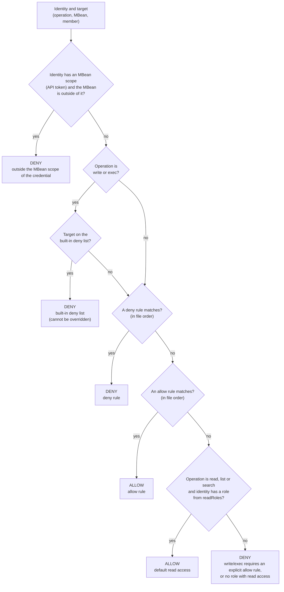

# 05 - Authorization policy

Authentication establishes *who* is calling. The policy decides *what* that caller may do with
which MBean, attribute or operation. It is evaluated for every single access on every endpoint -
REST, Jolokia compatibility, metrics, streaming and the normalized resource view.

The policy lives in the `policy` section of `rocoto.yaml`; see the
[configuration reference](../reference/configuration.md) for the key list. `rocoto.yaml` is read
at start-up, so policy changes need a redeploy or restart. An invalid rule aborts start-up
(Rocoto fails closed).

## The model

**Operations.** Every access is one of five operations:

| Operation | Meaning | Mutating |
|-----------|---------|----------|
| `read` | read an attribute value; receive notifications (pseudo attribute `@notifications`) | no |
| `list` | see that an MBean exists and read its metadata | no |
| `search` | find MBeans by pattern | no |
| `write` | set an attribute | yes |
| `exec` | invoke an operation | yes |

**Roles.** An identity has a set of role names. The policy compares them literally with the roles
in `readRoles` and in rules. Rocoto ships three conventional names - `rocoto-reader`,
`rocoto-operator`, `rocoto-admin` - but none of them has built-in privileges beyond being listed
in the default `readRoles`.

**The default, without any rule:**

- `read`, `list` and `search` are allowed for identities with at least one of `policy.readRoles`
  (default: all three standard roles).
- `write` and `exec` are denied for everybody, including `rocoto-admin`.
- An identity with none of the read roles sees nothing: searches are empty, reads are `403`.

## Rule syntax

```yaml
policy:
  readRoles: [rocoto-reader, rocoto-operator, rocoto-admin]
  rules:
    - roles: [rocoto-operator, rocoto-admin]   # who
      allow: [exec]                            # what: read | write | exec | list | search | all
      mbean: "java.lang:type=Memory"           # where: ObjectName or ObjectName pattern
      operations: [gc]                         # which members: globs, optional
    - deny: [read]
      mbean: "java.lang:type=Runtime"
      attributes: [SystemProperties, InputArguments]
```

| Key | Required | Meaning |
|-----|----------|---------|
| `allow` or `deny` | exactly one | List of operations. `all` or `*` means all five. `read` always includes `list` and `search`. |
| `roles` | for `allow` rules | The rule applies to identities with at least one of these roles. A `deny` rule without `roles` applies to everybody. |
| `mbean` | yes | An ObjectName or pattern with the usual JMX semantics: `java.lang:*`, `Catalina:type=Manager,*`, `jboss.as:subsystem=datasources,data-source=*,statistics=pool`. |
| `attributes`, `operations`, `members` | no | Case-insensitive globs (`*`, `?`) over the attribute name (read, write) or operation name (exec). The three keys are synonyms and are merged into one list; use the one that reads best. Omitted means all members. |

How member globs interact with `list` and `search` (which address a whole MBean, not a member):

- An **allow** rule restricted to some members still lets the MBean be listed and found.
- A **deny** rule restricted to some members does **not** hide the MBean; it only removes those
  attributes from descriptions and bulk reads and turns direct reads into `403`.
- A `deny: [read]` rule **without** member globs hides the matching MBeans completely: they
  disappear from search results, and describing or reading them is `403`.

## Evaluation order

`AccessPolicy.decide` - the first match wins:



A rule matches when all of the following hold: the operation is in the rule's list, the identity
has one of the rule's roles (or the rule has none), the MBean matches the pattern, and the member
matches one of the globs (or the rule has none).

Consequences:

- **Deny beats allow**, regardless of the order in the file. Order only matters among rules of the
  same kind, and since the first match of a kind decides with the same effect, it does not change
  the outcome.
- An `allow: [read]` rule can grant read access to a role that is *not* in `readRoles`, for
  selected MBeans only.
- Every denial is answered with the same `403 Access denied by policy`. The reason shown in the
  diagram is written to the audit log only.

## The built-in deny list

Some MBeans turn any JMX bridge into remote code execution, arbitrary file access or credential
theft. For these, `write` and `exec` are blocked before any rule is looked at, and **no
configuration can override this**. Reading stays subject to the normal policy.

| Target (write and exec) | Reason |
|-------------------------|--------|
| `ch.qos.logback.classic:*` | logback's JMXConfigurator allows loading remote configuration (`reloadByURL`: attacker-controlled XML, JNDI, XXE, code execution) |
| `org.apache.logging.log4j2:*` | the log4j2 configuration can be replaced remotely (`setConfigText`, `setConfigLocationUri`) |
| `com.sun.management:type=DiagnosticCommand` | diagnostic commands (jcmd over JMX) can load native agents, change compiler directives, write dumps |
| `com.sun.management:type=HotSpotDiagnostic` | heap dumps to arbitrary paths and VM option changes |
| `jdk.management.jfr:*` | Flight Recorder writes files to arbitrary locations |
| operation `getMBeansFromURL` on any MBean | MLet loads remote code |
| operation `addURL` on any MBean | MLet loads remote code |
| `javax.management.loading:*` | MLet loads remote code |
| `JMImplementation:*` | the MBeanServer delegate |
| `jboss.as:subsystem=elytron,*` and `jboss.as.expr:subsystem=elytron,*` | Elytron security configuration (realms, credential stores, key stores) |
| `jboss.as:core-service=management,*` and `jboss.as.expr:core-service=management,*` | WildFly's management interface and its access control |
| `jboss.as:core-service=vault` | the legacy vault |
| `Catalina:type=MBeanFactory` | creates arbitrary Tomcat components (realms, valves, connectors) |
| `Users:*` | Tomcat's user database |
| `io.rocoto:*` | Rocoto internals - Rocoto protects itself |

The integration tests verify the "cannot be overridden" part: a policy that explicitly allows
`exec` on `DiagnosticCommand` for `rocoto-admin` still yields `403`, and the audit log records
`built-in deny list: diagnostic commands can load native agents`.

## Masking

Values whose *name* suggests a secret are replaced by `********` on the server. The value is not
serialized, not logged and not exported as a metric; for a masked attribute the MBean is not even
asked for the value.

Built-in patterns (case-insensitive globs): `*password*`, `*passwd*`, `*secret*`, `*credential*`,
`*privatekey*`, `*private-key*`, `*apikey*`, `*api-key*`, `*accesskey*`, `*authtoken*`,
`*clear-text*`, `*cleartext*`.

Add your own; the list is extended, never replaced:

```yaml
policy:
  mask: ["*jdbcUrl*", "connectionUrl", "*passphrase*"]
```

Masking applies to:

- attribute names (`read`, bulk reads, streaming; `describe` marks them with `"masked": true`)
- keys inside `CompositeData`, maps and MXBean `Map` values, at any nesting depth
- the previous value returned by a write to a masked attribute
- the value of a write to a masked attribute in the audit log, and operation arguments whose
  declared parameter name matches a pattern
- metrics and the normalized resource view, which skip masked values

Masking is by name, not by content: a password inside an attribute called `Description` is not
detected. Use a `deny: [read]` rule for such attributes.

```bash
curl -s -u rita -H "Content-Type: application/json" \
  -d '{"mbean":"jboss.as:subsystem=datasources,data-source=ExampleDS","attribute":"password"}' \
  https://server:8443/rocoto/api/v1/read
# {"mbean":"jboss.as:data-source=ExampleDS,subsystem=datasources","attribute":"password","value":"********"}
```

## Audit log

Every audit record is one JSON line. Records always go to the `java.util.logging` logger
`io.rocoto.audit` (level `INFO`) and thereby into the application server's log, where they can be
routed to a dedicated handler. With `audit.file` they are additionally appended to a file; if
that file cannot be opened, Rocoto refuses to start.

| What | Recorded |
|------|----------|
| denied access (any operation) | always, with the reason |
| reads the policy allowed but the application server itself refused (for example WildFly management RBAC) | always, as `DENIED` with the reason `denied by the application server` |
| `write` and `exec`, successful or failed | always (a refusal by the application server is recorded as `FAILED`) |
| failed and locked logins of built-in authentication | always |
| credentials rejected by the container (`container` and `chain` mode) | always, as `AUTH_FAILED` with `auth: container` and the reason `rejected by the application server's security domain`; `user` is `null` |
| successful reads | only with `audit.reads: true` (high volume with metrics and streaming) |
| operation arguments | only with `audit.execArguments: true` - they may contain secrets, and JMX rarely exposes parameter names that would allow masking |
| values of attribute writes | always, masked if the attribute name is masked |

Fields (from `AuditEvent.toMap`):

| Field | Content |
|-------|---------|
| `ts` | ISO-8601 timestamp (UTC) |
| `user` | identity name, `token:<id>` for API tokens; for failed built-in logins the presented name, if any; `null` for logins rejected by the container and for requests without a recognizable user name |
| `auth` | identity source: `basic`, `token`, `mtls`, `jwt`, `container`, `internal`; for login events `builtin` or `container` (who rejected the credentials) |
| `remote` | client address (`websocket` for WebSocket subscriptions, `local` for the OTLP exporter) |
| `channel` | `api`, `jolokia`, `metrics`, `stream` or `auth` |
| `action` | `READ`, `WRITE`, `EXEC`, `LIST`, `SEARCH` or `LOGIN` |
| `mbean` | canonical ObjectName (absent for logins) |
| `member` | attribute or operation name (absent where not applicable) |
| `outcome` | `ALLOWED`, `DENIED`, `FAILED`, `AUTH_FAILED`, `AUTH_LOCKED` |
| `reason` | why it was denied or failed (absent on success) |
| `args` | written value or operation arguments, converted with depth and size limits and masking |

Example lines:

```json
{"ts":"2026-09-18T09:41:07.512Z","user":"otto","auth":"basic","remote":"10.0.0.17","channel":"api","action":"EXEC","mbean":"java.lang:type=Memory","member":"gc","outcome":"ALLOWED"}
{"ts":"2026-09-18T09:41:12.030Z","user":"rita","auth":"basic","remote":"10.0.0.17","channel":"api","action":"EXEC","mbean":"java.lang:type=Memory","member":"gc","outcome":"DENIED","reason":"write/exec requires an explicit allow rule"}
{"ts":"2026-09-18T09:42:55.871Z","user":"ada","auth":"basic","remote":"10.0.0.17","channel":"api","action":"WRITE","mbean":"java.lang:type=Memory","member":"Verbose","outcome":"ALLOWED","args":true}
{"ts":"2026-09-18T09:43:20.114Z","user":"ada","auth":"basic","remote":"10.0.0.17","channel":"jolokia","action":"EXEC","mbean":"com.sun.management:type=DiagnosticCommand","member":"vmVersion","outcome":"DENIED","reason":"built-in deny list: diagnostic commands can load native agents"}
{"ts":"2026-09-18T09:44:01.402Z","user":"ada","auth":"builtin","remote":"203.0.113.9","channel":"auth","action":"LOGIN","outcome":"AUTH_FAILED","reason":"wrong user name or password"}
{"ts":"2026-09-18T09:44:09.120Z","user":null,"auth":"container","remote":"203.0.113.9","channel":"auth","action":"LOGIN","outcome":"AUTH_FAILED","reason":"rejected by the application server's security domain"}
{"ts":"2026-09-18T09:45:30.006Z","user":"carl","auth":"container","remote":"10.0.0.17","channel":"api","action":"READ","mbean":"jboss.as:subsystem=datasources,data-source=ExampleDS","member":"userName","outcome":"DENIED","reason":"denied by the application server"}
```

```yaml
audit:
  file: /var/log/rocoto/audit.log
  reads: false
  execArguments: false
```

Rocoto appends to the file and does not rotate it. Use `logrotate` with `copytruncate`, or route
the `io.rocoto.audit` logger to a rotating handler of the application server and leave
`audit.file` unset.

## Recipes

### Read-only monitoring

This is the default; no rule is needed. Create users or tokens with `rocoto-reader`:

```bash
java -jar rocoto-tools.jar user add rita --roles rocoto-reader --file rocoto-users.yaml
```

### The operator may run a garbage collection

```yaml
policy:
  rules:
    - roles: [rocoto-operator, rocoto-admin]
      allow: [exec]
      mbean: "java.lang:type=Memory"
      operations: [gc]
```

```bash
curl -s -u otto -H "Content-Type: application/json" \
  -d '{"mbean":"java.lang:type=Memory","operation":"gc"}' \
  https://server:8443/rocoto/api/v1/exec
# {"mbean":"java.lang:type=Memory","operation":"gc","value":null}
```

### The admin may change log levels

With `java.util.logging` (Tomcat's JULI included), log levels are changed with the *operation*
`setLoggerLevel`, so the rule allows `exec`:

```yaml
policy:
  rules:
    - roles: [rocoto-admin]
      allow: [exec]
      mbean: "java.util.logging:type=Logging"
      operations: [setLoggerLevel]
```

```bash
curl -s -u ada -H "Content-Type: application/json" \
  -d '{"mbean":"java.util.logging:type=Logging","operation":"setLoggerLevel","arguments":["org.apache.catalina","FINE"]}' \
  https://server:8443/rocoto/api/v1/exec
```

On WildFly, log levels are *attributes* of the logging subsystem, so the rule allows `write`:

```yaml
policy:
  rules:
    - roles: [rocoto-admin]
      allow: [write]
      mbean: "jboss.as:subsystem=logging,logger=*"
      attributes: [level]
    - roles: [rocoto-admin]
      allow: [write]
      mbean: "jboss.as:subsystem=logging,root-logger=ROOT"
      attributes: [level]
```

```bash
curl -s -u ada -X PUT -H "Content-Type: application/json" -d '{"value":"DEBUG"}' \
  "https://server:8443/rocoto/api/v1/mbeans/jboss.as%3Asubsystem%3Dlogging%2Clogger%3Dcom.example/attributes/level"
```

WildFly's own management access control must permit the change as well (see
[04 - The JMX connection](04-jmx-connection.md)). The MBeans of logback and log4j2 are on the
built-in deny list and cannot be used for this.

### Hide sensitive attributes

```yaml
policy:
  mask: ["*jdbcUrl*"]                # show that the attribute exists, hide its value
  rules:
    - deny: [read]                   # hide individual attributes from everybody
      mbean: "java.lang:type=Runtime"
      attributes: [SystemProperties, InputArguments]
    - deny: [read]                   # hide whole MBeans from everybody
      mbean: "com.example.billing:*"
    - deny: [read]                   # hide from one role only
      roles: [rocoto-reader]
      mbean: "jboss.as:subsystem=datasources,*"
```

Command line arguments and system properties frequently contain passwords
(`-Djavax.net.ssl.keyStorePassword=...`); the first deny rule is a sensible addition to every
production policy.

### A token scoped for Prometheus

Restrict the scraper with the token's MBean scope instead of policy rules. The scope is checked
first, and it applies to this credential only:

```bash
java -jar rocoto-tools.jar token create prometheus --roles rocoto-reader --days 365 \
  --mbeans "java.lang:*;java.nio:*;Catalina:*" --file rocoto-users.yaml
```

The resulting entry in `rocoto-users.yaml`:

```yaml
tokens:
  - id: prometheus
    hash: "sha256$..."
    roles: [rocoto-reader]
    expires: "2027-09-18T10:00:00Z"
    mbeans: ["java.lang:*", "java.nio:*", "Catalina:*"]
```

Samples from MBeans outside the scope are silently missing from `/metrics`; nothing else has to
be configured. See [06 - Metrics](06-metrics.md).

### Give a role read access to one domain only

```yaml
policy:
  readRoles: [rocoto-operator, rocoto-admin]    # "app-team" is not a read role
  rules:
    - roles: [app-team]
      allow: [read]
      mbean: "com.example.shop:*"
```

Next: [06 - Metrics](06-metrics.md)
