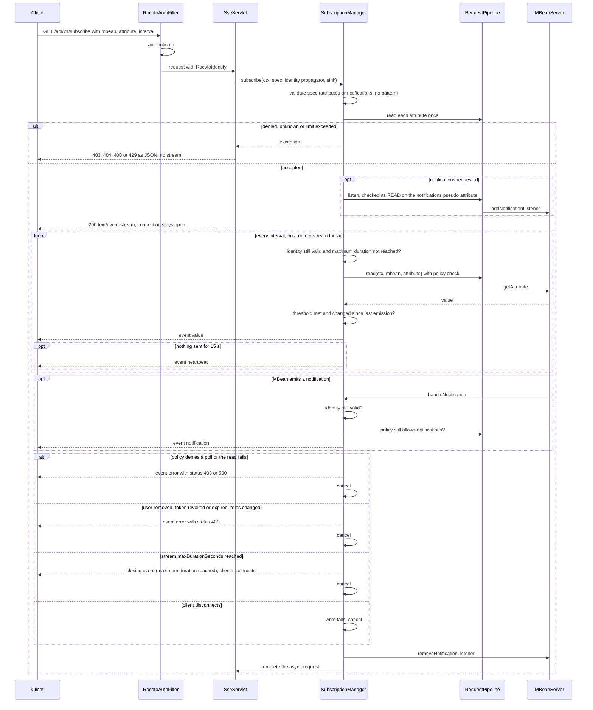
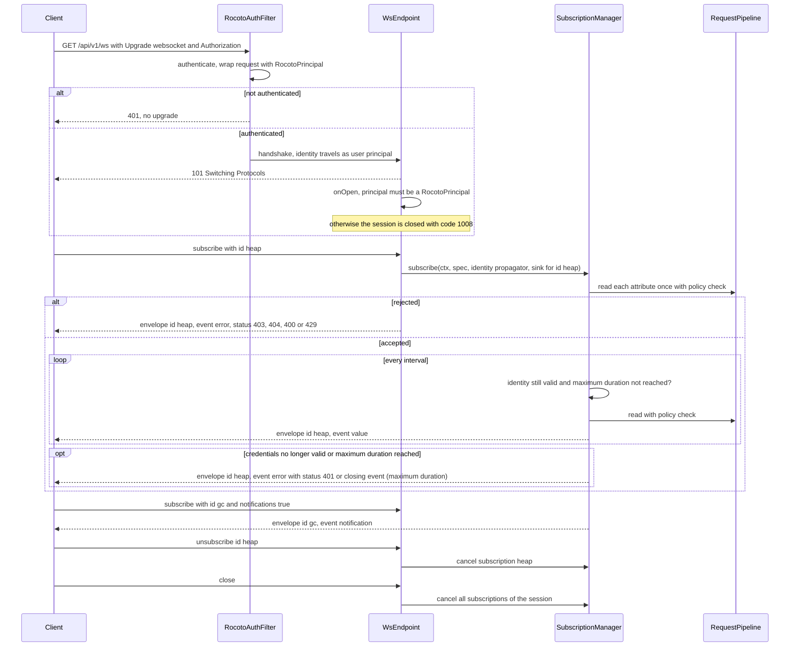

# 07 - Streaming

Instead of polling the REST API, a client can subscribe to attributes and JMX notifications of an
MBean and have Rocoto push changes. Two transports offer the same subscription model:

| Transport | Endpoint | Shape |
|-----------|----------|-------|
| Server-Sent Events (SSE) | `GET /api/v1/subscribe` | one subscription per HTTP connection, parameters in the query string |
| WebSocket | `/api/v1/ws` | many subscriptions multiplexed over one connection, JSON messages |

Both pass the authentication filter like any other request, and every value is read through the
request pipeline. Configuration keys (`stream.*`) are in the
[configuration reference](../reference/configuration.md).

## The subscription model

| Parameter | SSE query parameter | WebSocket field | Default | Meaning |
|-----------|--------------------|-----------------|---------|---------|
| MBean | `mbean` | `"mbean"` | required | a concrete ObjectName; patterns are rejected with `400` |
| attributes | `attribute` (repeatable) | `"attributes": [...]` | none | attributes to poll |
| interval | `interval` | `"interval"` | 1000 ms (or `stream.minIntervalMillis` if larger) | polling interval in milliseconds; values below `stream.minIntervalMillis` are raised to it |
| on change | `onChange` | `"onChange"` | `true` | only emit when the values differ from the previous emission |
| thresholds | `above`, `below` | `"above"`, `"below"` | none | only emit while the value is greater than / less than the number |
| notifications | `notifications=true` | `"notifications": true` | `false` | also forward the MBean's JMX notifications |

A subscription needs at least one attribute or `notifications`; otherwise the answer is `400`.

### Events

| Event | Data | When |
|-------|------|------|
| `value` | `{"mbean", "ts", "values": {attribute: value, ...}}` | after a poll, subject to `onChange` and thresholds. The first poll runs immediately. |
| `notification` | `{"mbean", "ts", "type", "message", "sequenceNumber", "userData"}` | the MBean emitted a JMX notification |
| `error` | `{"status", "error"}` | the subscription failed: `403` policy denial, `401` `Credentials are no longer valid`, `500` read failure. It is cancelled right after this event. |
| `end` | `{"reason": "maximum stream duration reached - reconnect"}` | the subscription reached `stream.maxDurationSeconds`; it is cancelled right after this event and the client is expected to reconnect |
| `heartbeat` | `{"ts"}` | nothing was sent for more than 15 seconds (checked on each poll tick) |

Values are converted exactly like in the REST API (type fidelity, masking); see
[04 - The JMX connection](04-jmx-connection.md).

### Thresholds

`above` and `below` apply to the **first** attribute of the subscription, which must be numeric.
A `value` event is only emitted while the condition holds; with both set, while
`above < value < below`. If the first value is not a JSON number - a string, a composite value,
or a `long` beyond 2^53 that is transported as a string - nothing is emitted.

Thresholds combine with `onChange`: with the default `onChange=true` a value that stays above the
threshold but does not change is sent once. Use `onChange=false` to get an event on every poll
while the condition holds.

### Security properties

- **Checked before the stream starts.** Every attribute is read once while the request is still
  an ordinary HTTP request. A denied attribute yields `403`, an unknown MBean or attribute `404` -
  as a normal JSON error response, not as a stream.
- **Policy re-check on every poll.** Each poll is a `RequestPipeline.read` with the subscriber's
  identity: policy decision, masking and (with `audit.reads`) audit apply every time. On WildFly
  the poll additionally runs as the caller's Elytron identity, so WildFly's management RBAC is
  re-evaluated too. A denial ends the subscription with an `error` event (`403`).
- **Notifications are a permission.** Receiving the notifications of an MBean is a `read` on the
  pseudo attribute `@notifications`. It is checked when the listener is registered and again for
  every notification delivered.
- **Credentials are re-validated while the stream runs.** Before every poll and before every
  notification is delivered, Rocoto checks that the identity is still valid: the built-in user
  still exists, the API token still exists and has not expired, and the roles are the same as
  when the subscription was created. If not - the user was removed, the token revoked or expired,
  roles were changed - the subscription ends with an `error` event (`{"status":401,"error":
  "Credentials are no longer valid"}`). The check happens on the next poll tick, so it takes
  effect within one polling interval (plus the two seconds of the user store reload).
- **Every stream has a maximum duration.** Identities established by the container, a JWT or a
  client certificate cannot be re-validated without the original request. Therefore *every*
  subscription ends after `stream.maxDurationSeconds` (default 3600; `0` = unlimited) with an
  `end` event, and the client has to reconnect - and thereby authenticate again. Choose a value
  that matches the lifetime of your JWTs or the time within which a disabled directory account
  must lose access. A changed password alone does not end a running stream of a built-in user.
- **Limits.** `stream.maxSubscriptions` (default 200) in total and
  `stream.maxSubscriptionsPerUser` (default 20) per identity name; beyond that the answer is
  `429 Too many active subscriptions`. `stream.minIntervalMillis` (default 500, never below 100)
  bounds the polling rate. All subscriptions share `stream.threads` (default 2) scheduler threads.

By default the policy lets read roles receive notifications, because `@notifications` is handled
like any attribute. To restrict them:

```yaml
policy:
  rules:
    - deny: [read]
      roles: [rocoto-reader]
      mbean: "*:*"
      attributes: ["@notifications"]
```

## Server-Sent Events

```bash
curl -N -H "Authorization: Bearer $TOKEN" \
  "https://server:8443/rocoto/api/v1/subscribe?mbean=java.lang:type=Threading&attribute=ThreadCount&attribute=PeakThreadCount&interval=2000"
```

```text
event: value
data: {"mbean":"java.lang:type=Threading","ts":"2026-09-18T10:15:30.120Z","values":{"ThreadCount":41,"PeakThreadCount":57}}

event: value
data: {"mbean":"java.lang:type=Threading","ts":"2026-09-18T10:15:34.131Z","values":{"ThreadCount":43,"PeakThreadCount":57}}

event: heartbeat
data: {"ts":"2026-09-18T10:15:50.140Z"}
```

After `stream.maxDurationSeconds` the stream ends with a final event and the server closes the
connection; a client that wants to keep listening opens a new one:

```text
event: end
data: {"reason":"maximum stream duration reached - reconnect"}
```

`-N` disables curl's output buffering. The response has `Content-Type: text/event-stream` and
`X-Accel-Buffering: no`, which keeps nginx from buffering the stream; other reverse proxies may
need their own setting, and their idle timeout should exceed the 15 second heartbeat.

Alert-style subscription: the CPU load of the JVM process, but only while it is above 90 %, on
every poll:

```bash
curl -N -u rita \
  "https://server:8443/rocoto/api/v1/subscribe?mbean=java.lang:type=OperatingSystem&attribute=ProcessCpuLoad&above=0.9&onChange=false&interval=5000"
```

Notifications only (garbage collection events of one collector; quote the URL, encode spaces):

```bash
curl -N -u rita \
  "https://server:8443/rocoto/api/v1/subscribe?mbean=java.lang:type=GarbageCollector,name=G1%20Young%20Generation&notifications=true"
```

```text
event: notification
data: {"mbean":"java.lang:name=G1 Young Generation,type=GarbageCollector","ts":"2026-09-18T10:16:02.517Z","type":"com.sun.management.gc.notification","message":"G1 Young Generation","sequenceNumber":12,"userData":{"gcAction":"end of minor GC","gcCause":"G1 Evacuation Pause","gcName":"G1 Young Generation"}}
```

(The example is shortened: the real `userData` of a GC notification also contains `gcInfo` with
durations and memory usage before and after the collection.)

### Lifecycle



## WebSocket

Connect to `wss://server:8443/rocoto/api/v1/ws` with an `Authorization` header on the upgrade
request. An upgrade without valid credentials is answered with `401` like any other request. With
`stream.websocket: false`, or on a server without a WebSocket container, the endpoint is not
registered and streaming is offered over SSE only.

### Protocol

Client to server - text frames with one JSON object, at most 64 KiB:

```json
{"action":"subscribe","id":"heap","mbean":"java.lang:type=Memory","attributes":["HeapMemoryUsage"],"interval":1000}
{"action":"subscribe","id":"gc","mbean":"java.lang:type=GarbageCollector,name=G1 Young Generation","notifications":true}
{"action":"unsubscribe","id":"heap"}
```

| Field | Meaning |
|-------|---------|
| `action` | `subscribe` or `unsubscribe` |
| `id` | required, chosen by the client, at most 64 characters, unique among the active subscriptions of the connection |
| `mbean`, `attributes`, `interval`, `onChange`, `above`, `below`, `notifications` | as in the table above; `interval`, `above` and `below` must be JSON numbers, `onChange` and `notifications` JSON booleans |

Server to client - every message is an envelope that carries the subscription id:

```json
{"id":"heap","event":"value","data":{"mbean":"java.lang:type=Memory","ts":"2026-09-18T10:15:30.120Z","values":{"HeapMemoryUsage":{"committed":268435456,"init":268435456,"max":4294967296,"used":73400320}}}}
{"id":"heap","event":"heartbeat","data":{"ts":"2026-09-18T10:15:50.140Z"}}
{"id":"nope","event":"error","data":{"status":404,"error":"No MBean registered as com.example:type=Nope"}}
{"id":"heap","event":"end","data":{"reason":"maximum stream duration reached - reconnect"}}
```

- A rejected `subscribe` (denied, not found, limit reached, invalid message, duplicate id) is
  answered with an `error` event for that id; the connection stays open. Malformed messages get
  status `400`; if the message has no usable `id`, the envelope's `id` is `null`.
- There is no acknowledgement for `subscribe` or `unsubscribe`. A successful subscription shows
  itself by its first `value` event, which is sent immediately unless a threshold suppresses it.
- After an `error` event with a status other than `401` the subscription is gone and its id can
  be reused; the connection stays open.
- The identity of a WebSocket connection comes from its handshake. After an `end` event
  (`stream.maxDurationSeconds` reached) or an `error` with status `401` (credentials no longer
  valid) Rocoto closes the whole connection with close code 1008, so the client has to open a
  new connection and authenticate again.
- Closing the connection cancels all of its subscriptions.
- In the audit log, WebSocket subscriptions have the channel `stream` and the remote address
  `websocket`.

Example with [websocat](https://github.com/vi/websocat):

```bash
websocat -H "Authorization: Bearer $TOKEN" wss://server:8443/rocoto/api/v1/ws
{"action":"subscribe","id":"threads","mbean":"java.lang:type=Threading","attributes":["ThreadCount"],"interval":2000}
```

Example with the JDK HTTP client, which can set headers on the upgrade request:

```java
WebSocket ws = HttpClient.newHttpClient().newWebSocketBuilder()
        .header("Authorization", "Bearer " + token)
        .buildAsync(URI.create("wss://server:8443/rocoto/api/v1/ws"), listener)
        .join();
ws.sendText("{\"action\":\"subscribe\",\"id\":\"threads\",\"mbean\":\"java.lang:type=Threading\","
        + "\"attributes\":[\"ThreadCount\"],\"interval\":2000}", true);
```

### Lifecycle



## Browsers

Rocoto requires credentials on every request, and that includes the request that opens a stream.
Browser APIs limit how credentials can be attached:

- **`EventSource` cannot send an `Authorization` header.** Use `fetch()` with a streaming response
  body instead, which can:

  ```javascript
  const response = await fetch("/rocoto/api/v1/subscribe?mbean=java.lang:type=Threading&attribute=ThreadCount", {
    headers: { Authorization: "Bearer " + token, Accept: "text/event-stream" }
  });
  const reader = response.body.pipeThrough(new TextDecoderStream()).getReader();
  for (;;) {
    const { value, done } = await reader.read();
    if (done) break;
    // split value into SSE events: blocks separated by an empty line, fields "event:" and "data:"
  }
  ```

- **The browser `WebSocket` API cannot set request headers either.** WebSocket with an
  `Authorization` header is for server-side and other non-browser clients (Java, Node.js, Go,
  Python, `websocat`).
- For `EventSource` or `WebSocket` from a browser, the credentials must be something the browser
  attaches by itself: container authentication (`auth.mode: container` or `chain`) with a
  mechanism such as HTTP Basic handled by the browser, a container session, or a TLS client
  certificate - or a same-origin reverse proxy that adds the `Authorization` header. Do not put
  tokens into the URL; Rocoto does not read credentials from query parameters.
- **Origin rules apply.** Browsers send an `Origin` header with cross-origin `fetch()` calls and
  with every WebSocket handshake. Pages from another origin are rejected with `403` unless the
  origin is listed in `cors.allowedOrigins`. Keep a token that lives in browser JavaScript
  narrowly scoped and short-lived.

Next: [08 - REST API](08-rest-api.md)
