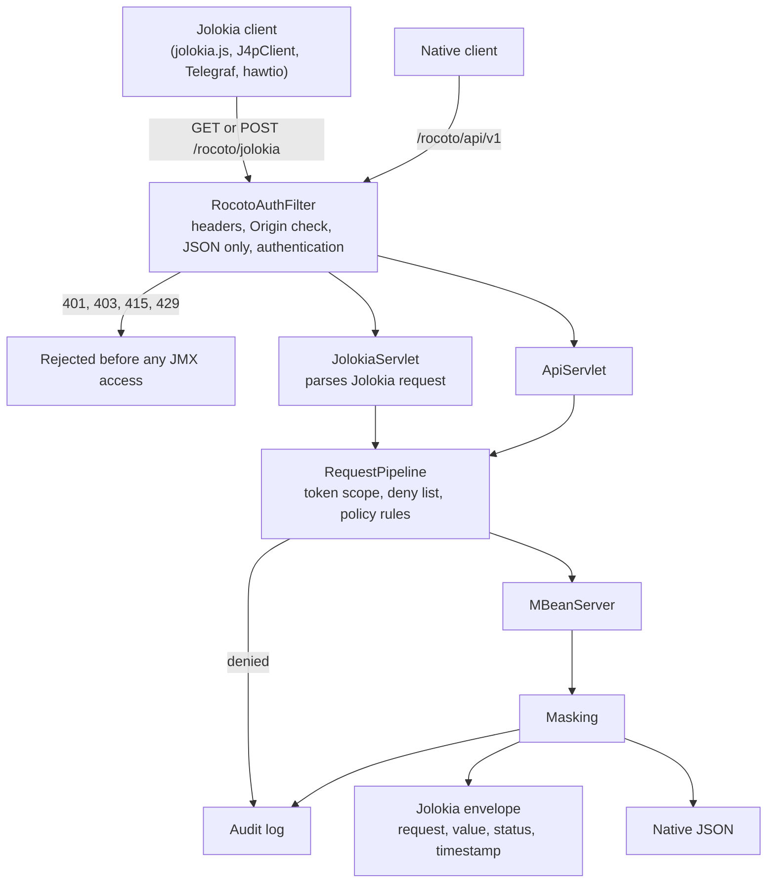

# 9. Jolokia compatibility and migration

Rocoto speaks the Jolokia protocol (reported protocol version `7.2`) on `<context>/jolokia`, by
default `https://host:8443/rocoto/jolokia`. Existing Jolokia clients, dashboards and monitoring
checks keep working after you change their URL and give them credentials. This chapter describes
what is supported, where Rocoto deliberately differs, and how to migrate.

Compatibility is not only claimed but tested with the real thing: the integration test
`rocoto-it/src/test/java/io/rocoto/it/JolokiaClientIT.java` drives `/jolokia` with the
**unmodified jolokia-client-java 2.1.1** (`J4pClient`): `version`, `read` including inner path
and ObjectName patterns, `search`, `list`, bulk requests, `write`, `exec`, and the mapping of
errors to `J4pRemoteException`. In addition, the WildFly smoke test in CI reads through
`/jolokia` and checks that a proxy-mode request is answered with status `403`.

The endpoint is enabled by default. If you do not need it, switch it off:

```yaml
compat:
  jolokia:
    enabled: false      # /jolokia then answers 404
```

A second key, `compat.jolokia.allowGetMutations` (default `true`), controls whether `write` and
`exec` may be sent as GET URLs; see [GET and state changes](#get-and-state-changes).

## Same pipeline, different dialect

The Jolokia endpoint is a translation layer only. It has no access path of its own: requests pass
the same authentication filter and the same policy / masking / audit pipeline as native requests.
Audit records of Jolokia requests carry `"channel":"jolokia"`.



## Supported operations

### `read`

```bash
curl -s -u rita $ROCOTO/jolokia/read/java.lang:type=Memory/HeapMemoryUsage/used
```

```json
{
  "request": { "type": "read", "mbean": "java.lang:type=Memory",
               "attribute": "HeapMemoryUsage", "path": "used" },
  "value": 84152320,
  "timestamp": 1789720000,
  "status": 200
}
```

Supported variants:

| Variant | Example |
|---|---|
| single attribute | `{"type":"read","mbean":"java.lang:type=Memory","attribute":"Verbose"}` |
| inner path | `"path":"used"` or GET `/read/<mbean>/<attribute>/<path...>`; works on objects and array indexes |
| multiple attributes | `"attribute":["ThreadCount","PeakThreadCount"]` returns an object keyed by attribute |
| all attributes | omit `attribute` |
| ObjectName pattern | `"mbean":"java.lang:type=MemoryPool,*"` returns an object keyed by ObjectName, then attribute; combinable with one or several attributes |

A pattern that matches more than `api.maxPatternMBeans` MBeans (default 1000) is refused with
status `413` in the envelope (`error_type` `java.lang.Exception`). A pattern that yields no
readable value results in a `404` /
`javax.management.InstanceNotFoundException`, as in Jolokia. In pattern reads and all-attribute
reads, attributes the caller may not read are silently left out.

### `write`

```bash
curl -s -u ada -H 'Content-Type: application/json' \
  -d '{"type":"write","mbean":"java.lang:type=Memory","attribute":"Verbose","value":true}' \
  $ROCOTO/jolokia
```

`value` in the response is the previous value, as in Jolokia. The GET form
`/write/<mbean>/<attribute>/<value>` works as well for non-browser clients (see
[GET and state changes](#get-and-state-changes)); the value `[null]` stands for `null`. Writing
to an inner `path` is **not** supported (`400`). A write needs an allow rule.

### `exec`

```bash
curl -s -u otto $ROCOTO/jolokia/exec/java.lang:type=Memory/gc
curl -s -u otto -H 'Content-Type: application/json' -d '{
  "type": "exec",
  "mbean": "java.lang:type=Threading",
  "operation": "getThreadInfo(long,int)",
  "arguments": [1, 5]
}' $ROCOTO/jolokia
```

- Overloaded operations are selected with Jolokia's signature syntax
  `operation(type1,type2)`, e.g. `getThreadInfo(long,int)` or `dumpAllThreads(boolean,boolean)`.
  `op()` selects the variant without parameters. Type names are JMX type names (`[J` for
  `long[]`).
- GET requests carry arguments as path segments, all strings. They are converted according to the
  operation's declared parameter types. `[null]` is `null`, `""` (two quote characters) is the
  empty string, and for array, `List` and `Set` parameters the string is split at commas:
  `/exec/com.example:type=Cache/evict/a,b,c`.
- Arguments are converted by the same closed set of converters as in the native API
  ([chapter 8](08-rest-api.md#argument-conversion-json-to-java)).
- An exec needs an allow rule.

### GET and state changes

Jolokia allows `write` and `exec` as plain GET URLs (`/jolokia/write/...`, `/jolokia/exec/...`),
and the unmodified jolokia-client-java sends simple `write`/`exec` requests that way. A state
change triggered by a URL is what CSRF attacks are made of, so Rocoto accepts GET mutations from
**non-browser clients only**:

- A GET `write`/`exec` that carries a `Sec-Fetch-Site`, `Sec-Fetch-Mode` or `Origin` header -
  every current browser sends at least one of them - is answered with HTTP `405` and
  `{"status":405,"error":"write and exec must be sent with POST"}`. Browser code (jolokia.js)
  has to POST, which is protected by the JSON-only rule.
- `compat.jolokia.allowGetMutations: false` switches GET mutations off for everybody (`405`
  always). Recommended when all your clients can POST; see
  [chapter 11](11-security-hardening.md#csrf-in-detail) for the residual risk with very old
  browsers.

GET `read`, `search`, `list` and `version` are not affected.

### `search`

```bash
curl -s -u rita "$ROCOTO/jolokia/search/java.lang:type=Mem*"
```

```json
{ "request": { "type": "search", "mbean": "java.lang:type=Mem*" },
  "value": ["java.lang:type=Memory"], "timestamp": 1789720000, "status": 200 }
```

Only MBeans visible to the caller are returned.

### `list`

```bash
curl -s -u rita "$ROCOTO/jolokia/list/java.lang/type=Memory?maxDepth=2"
```

Returns Jolokia's tree `domain -> key properties -> {desc, class, attr, op}`. Each attribute has
`rw`, `type`, `desc`; each operation `args`, `ret`, `desc`; overloaded operations are an array.
`path` (POST) or the GET path segments select a subtree (`java.lang`, then `type=Memory`, then
`attr`, ...). With `maxDepth`, deeper levels are replaced by `1`, as Jolokia does. Attributes the
caller may not read do not appear. Notification metadata (`notif`) is not rendered.

### `version`

`GET /jolokia/` or `/jolokia/version`:

```json
{
  "request": { "type": "version" },
  "value": {
    "agent": "rocoto-0.1.0",
    "protocol": "7.2",
    "info": { "product": "WildFly", "vendor": "Rocoto", "version": "30.0.1.Final" },
    "config": { "agentType": "servlet", "agentDescription": "Rocoto Jolokia compatibility" }
  },
  "timestamp": 1789720000,
  "status": 200
}
```

### Bulk requests

A POST body that is a JSON array is executed item by item and answered with an array of
envelopes, each with its own `status`. The limit is `api.maxBulkRequests` (default 100); a larger
array is refused with HTTP `413`.

### GET path escaping

Jolokia's escape character `!` is honored: `!/` is a literal slash, `!!` a literal exclamation
mark. This is how Tomcat's context names are addressed with GET:

```bash
curl -s -u rita \
  "$ROCOTO/jolokia/read/Catalina:type=Manager,host=localhost,context=!/shop/activeSessions"
```

### Processing parameters

Given as query parameters or, for POST, in the request's `config` object (which takes precedence).

| Parameter | Support |
|---|---|
| `maxDepth` | yes; default 16 |
| `maxCollectionSize` | yes; default 10000 |
| `ignoreErrors` | yes; attributes that fail to read (and, in multi-attribute reads, denied ones) become `"ERROR: <message>"` values instead of failing the request |
| `canonicalNaming` | yes; default `true`; `false` keeps the key property order of registration |
| `mimeType` | `text/plain` is honored, everything else gives `application/json` |
| `callback` | **rejected with HTTP 400** (JSONP) |
| `maxObjects`, `includeStackTrace`, `serializeException`, `ifModifiedSince` and others | ignored |

## Response envelope and errors

Success: `request` (echo of the request), `value`, `timestamp` (epoch seconds), `status: 200`.

Error:

```json
{
  "request": { "type": "read", "mbean": "java.lang:type=Nope", "attribute": "X" },
  "error_type": "javax.management.InstanceNotFoundException",
  "error": "javax.management.InstanceNotFoundException : No MBean registered as java.lang:type=Nope",
  "status": 404
}
```

As with Jolokia, errors of a processed request are reported **inside the envelope with HTTP status
200**. There is never a `stacktrace` key.

| `status` | `error_type` | Cause |
|---|---|---|
| 400 | `java.lang.IllegalArgumentException` | unknown request type, missing field, invalid value, unknown or ambiguous operation, wrong argument count |
| 400 | `javax.management.MalformedObjectNameException` | invalid `mbean` |
| 400 | `java.lang.UnsupportedOperationException` | `notification` command, write to an inner path |
| 403 | `java.lang.SecurityException` | denied by policy, `target` (proxy mode) present, or refused by the application server |
| 404 | `javax.management.InstanceNotFoundException` | MBean not found, pattern without result |
| 404 | `javax.management.AttributeNotFoundException` | attribute not found, invalid inner path |
| 413 | `java.lang.Exception` | a pattern read matches more than `api.maxPatternMBeans` MBeans |
| 500 | `javax.management.MBeanException` | the MBean threw an exception |
| 500 | `java.lang.Exception` | unexpected error, message is `Internal error` |

Errors that occur *before* the Jolokia layer use real HTTP status codes and Rocoto's native error
body `{"status":...,"error":"..."}`: `401` (no or wrong credentials), `403` (credentials over
plain HTTP, foreign `Origin`, cross-site browser request), `405` (`write`/`exec` as GET from a
browser or with `allowGetMutations: false`), `415` (POST without `Content-Type:
application/json`), `429` (login lockout), `400` (`callback`), `404` (endpoint disabled), `413`
(body too large, too many bulk items), `503`. Jolokia client
libraries surface these as HTTP or parse errors.

Value rendering follows Jolokia: all numbers are JSON numbers (no string fallback for large
`long` values), `TabularData` is a nested object keyed by the index columns (an MXBean
`Map<K,V>` becomes a plain object), and `ObjectName` values are `{"objectName":"..."}`.

## Deliberate differences

| Jolokia | Rocoto | Why |
|---|---|---|
| Unauthenticated unless configured | **Authentication is mandatory** | An open JMX bridge is remote code execution waiting to happen |
| `write`/`exec` allowed unless restricted | Denied unless an allow rule exists; the built-in deny list cannot be overridden | Read-only by default |
| Proxy mode (`target` with a JMX service URL) | Does not exist; such a request gets `403` | CVE-2018-1000130 (JNDI injection) |
| JSONP via `callback` | HTTP `400` | Cross-site data leakage |
| `write`/`exec` as GET from anywhere | Accepted from non-browser clients only; `405` for requests with `Sec-Fetch-*` or `Origin` headers; can be switched off with `compat.jolokia.allowGetMutations: false` | CSRF |
| Pattern reads of any size | Refused with status `413` beyond `api.maxPatternMBeans` (default 1000) matches | Denial of service |
| `notification` command (pull/SSE) | `400`; use Rocoto's streaming API ([chapter 7](07-streaming.md)) | One streaming implementation, with per-subscription authorization |
| History MBean, `jolokia:type=Config`, discovery MBean | Not registered | No server-side state per client |
| `stacktrace` in error responses | Never returned | Information disclosure |
| Arbitrary Java beans serialized by reflection | Rendered with `toString()`; open types, collections, maps, arrays and common JDK types are fully supported | Reflection walks leak internals |
| Client-supplied class names for argument conversion | Closed set of target types | Deserialization gadgets |
| `jolokia-access.xml`, `jolokia.properties`, servlet init parameters | **Not read.** Convert the policy (below), configure everything else in `rocoto.yaml` | One configuration, one policy model |
| Sensitive values returned as is | Masked with `********` | |

POST requests must use `Content-Type: application/json`. Older Jolokia clients that post with
`text/plain` get `415`; current versions of jolokia.js and the Java client send JSON.

## Keeping the old URLs

A classic Jolokia WAR agent is reachable at `https://host/jolokia/...`. Rocoto's compatibility
endpoint lives at `<context root>/jolokia`, i.e. `https://host/rocoto/jolokia/...`. Deploying
Rocoto under the context root `/jolokia` does **not** reproduce the old URL: the endpoint would
then be `/jolokia/jolokia/...`, because the servlet mapping inside the WAR is fixed. The options
are:

1. **Change the base URL in the clients** to `https://host/rocoto/jolokia`. This is the
   recommended way; you have to touch the client configuration anyway to add credentials.
2. **Rewrite in the reverse proxy**, if one is in front of the server:

   ```nginx
   location /jolokia/ {
       proxy_pass https://appserver:8443/rocoto/jolokia/;
       proxy_set_header Host $host;
   }
   ```

   ```apache
   # Apache httpd; AllowEncodedSlashes/nocanon keep Jolokia's escaped paths intact
   AllowEncodedSlashes NoDecode
   ProxyPass        /jolokia/ https://appserver:8443/rocoto/jolokia/ nocanon
   ProxyPassReverse /jolokia/ https://appserver:8443/rocoto/jolokia/
   ```

If you want a different context root for other reasons, this is how it is set:

| Server | Context root comes from |
|---|---|
| WildFly / JBoss EAP | `<context-root>` in `WEB-INF/jboss-web.xml` (shipped as `/rocoto`). Change it with a deployment overlay, see [chapter 10](10-wildfly-elytron.md#pointing-rocoto-at-another-security-domain) for the mechanism |
| Tomcat | the WAR file name: `rocoto.war` gives `/rocoto`, `ops#jmx.war` gives `/ops/jmx` |
| Payara / GlassFish | `<context-root>` in `WEB-INF/glassfish-web.xml` (shipped as `/rocoto`), or `asadmin deploy --contextroot` |

## Migration checklist

1. Inventory the clients of the old agent: URL, request types used, whether any of them uses
   `write`/`exec`, proxy mode, JSONP or notifications. The last three have no equivalent.
2. Deploy Rocoto next to the old agent ([chapter 2](02-installation.md)). Both can run in
   parallel.
3. Create one credential per client, with the least privilege it needs
   ([chapter 3](03-authentication.md)). For monitoring: an API token with role `rocoto-reader`,
   an expiry date and an `mbeans` scope.
4. Convert `jolokia-access.xml` with `rocoto-tools policy convert` (next section), review the
   result and merge it into `rocoto.yaml`.
5. Add allow rules for every `write`/`exec` a client really performs
   ([chapter 5](05-authorization-policy.md)). Check that none of them is on the built-in deny
   list; those cannot be enabled.
6. Replace `<remote>` host restrictions with firewall rules or the application server's own
   means.
7. Point each client at `https://host/rocoto/jolokia` and add its credentials. Make sure it uses
   HTTPS: credentials over plain HTTP are refused with `403`.
8. Watch the audit log (`io.rocoto.audit`) for `DENIED` and `AUTH_FAILED` records while the
   clients run, and adjust the policy.
9. Undeploy the old agent. Remove `-javaagent:jolokia-agent.jar` from the JVM options if the JVM
   agent was used.
10. If nothing uses the Jolokia protocol anymore, set `compat.jolokia.enabled: false`.

## Converting `jolokia-access.xml`

```bash
java -jar rocoto-tools.jar policy convert jolokia-access.xml > policy-draft.yaml
```

Input:

```xml
<restrict>
  <remote><host>127.0.0.1</host></remote>
  <commands><command>read</command><command>exec</command></commands>
  <allow>
    <mbean>
      <name>java.lang:type=Memory</name>
      <attribute mode="read">HeapMemoryUsage</attribute>
      <attribute>Verbose</attribute>
      <operation>gc</operation>
    </mbean>
  </allow>
  <deny>
    <mbean>
      <name>com.example:type=Secrets,*</name>
      <attribute>*</attribute>
    </mbean>
  </deny>
</restrict>
```

Output:

```yaml
# Converted from jolokia-access.xml - REVIEW BEFORE USE.
# Rocoto is read-only by default and its built-in deny list always applies.
# NOTE: Jolokia allowed exec on every MBean that is not denied. Rocoto has no such blanket permission: only the MBeans listed in <allow> were converted. Add allow rules for anything else you really need.
# NOTE: <remote> host restrictions are not part of Rocoto's policy. Restrict network access in the application server or firewall; Rocoto authenticates every caller instead.
policy:
  rules:
    - roles: [rocoto-admin]
      allow: [exec]
      mbean: "java.lang:type=Memory"
      operations: ["gc"]
    - deny: [read, write]
      mbean: "com.example:type=Secrets,*"
      attributes: ["*"]
```

How the converter works:

- Jolokia has no users or roles. Everything that was allowed to anyone is granted to
  `rocoto-admin` only. Widen it to `rocoto-operator` where appropriate.
- `<allow>` attributes without `mode="read"` become `allow: [write]` rules, operations become
  `allow: [exec]` rules, but only if the `<commands>` section permitted `write` / `exec` (or was
  absent). In the example `write` was not a permitted command, so no write rule is generated for
  `Verbose`.
- `<deny>` entries become `deny` rules for everybody: attributes as `deny: [read, write]`,
  operations as `deny: [exec]`, an MBean without members as `deny: [all]`.
- `<remote>`, `<cors>` and `<http>` are not converted; a `NOTE` comment explains what to do
  instead.
- The XML is parsed with DTDs and external entities disabled; a file containing a `DOCTYPE` is
  rejected.

## Client configuration

All clients need two changes: the new URL and credentials. The examples use HTTP Basic, which
every Jolokia client supports. Use a dedicated user with `rocoto-reader` unless the client has
to write or execute.

### jolokia-client-java (`J4pClient`)

```java
J4pClient client = J4pClient.url("https://app.example.com:8443/rocoto/jolokia")
        .user("monitor")
        .password(System.getenv("ROCOTO_PASSWORD"))
        .connectionTimeout(5000)
        .build();

J4pReadResponse response = client.execute(
        new J4pReadRequest("java.lang:type=Memory", "HeapMemoryUsage"));
Map<String, Long> usage = response.getValue();
```

Do not configure a `J4pTargetConfig` (proxy mode); such requests are answered with status `403`.
The client sends simple `exec` and `write` requests as GET; that works as long as
`compat.jolokia.allowGetMutations` is `true` (the default). This client, in version 2.1.1, is the
one the integration test `JolokiaClientIT` uses.

### jolokia.js

```javascript
const jolokia = new Jolokia({
  url: "https://app.example.com:8443/rocoto/jolokia",
  username: "monitor",
  password: password,
  method: "post"          // JSON POST; JSONP is not available
});

jolokia.request(
  { type: "read", mbean: "java.lang:type=Memory", attribute: "HeapMemoryUsage" },
  { success: (r) => console.log(r.value.used), error: (r) => console.warn(r.error) }
);
```

If the page is not served from the same origin as Rocoto, add its origin to
`cors.allowedOrigins`; otherwise the browser's requests are refused with `403`. `jsonp: true` and
the notification support of jolokia.js are not available. Periodic polling with `register()`
works because it only issues ordinary bulk requests.

### Telegraf (`inputs.jolokia2_agent`)

```toml
[[inputs.jolokia2_agent]]
  urls = ["https://app.example.com:8443/rocoto/jolokia"]
  username = "telegraf"
  password = "${ROCOTO_TELEGRAF_PASSWORD}"
  # tls_ca = "/etc/telegraf/ca.pem"

  [[inputs.jolokia2_agent.metric]]
    name  = "jvm_memory"
    mbean = "java.lang:type=Memory"
    paths = ["HeapMemoryUsage", "NonHeapMemoryUsage"]

  [[inputs.jolokia2_agent.metric]]
    name     = "jvm_memory_pool"
    mbean    = "java.lang:type=MemoryPool,name=*"
    paths    = ["Usage"]
    tag_keys = ["name"]
```

Do not use `inputs.jolokia2_proxy`; proxy mode does not exist. If Prometheus is an option,
Rocoto's own `/metrics` endpoint ([chapter 6](06-metrics.md)) avoids the detour via Jolokia.

### hawtio

In hawtio's **Connect** tab add a connection with:

| Field | Value |
|---|---|
| Scheme | `https` |
| Host / Port | your server |
| Path | `/rocoto/jolokia` |

hawtio asks for user name and password when connecting. Remote connections of hawtio normally go
through hawtio's own server-side proxy servlet, which forwards the `Authorization` header; the
target host must then be on hawtio's proxy allow list (`hawtio.proxyAllowlist`). Only if your
hawtio build talks to Rocoto directly from the browser does its origin (for example
`https://hawtio.example.com`) have to be listed in `cors.allowedOrigins`. hawtio's plugins make heavy use of `list`, `search` and bulk `read`, which
work for a `rocoto-reader`. Plugin actions that `exec` or `write` (for example stopping a Camel
route) need matching allow rules and are otherwise shown as failed with a `SecurityException`.
Features relying on Jolokia's proxy mode or notifications are not available.

## Next

[10. WildFly and Elytron](10-wildfly-elytron.md)
