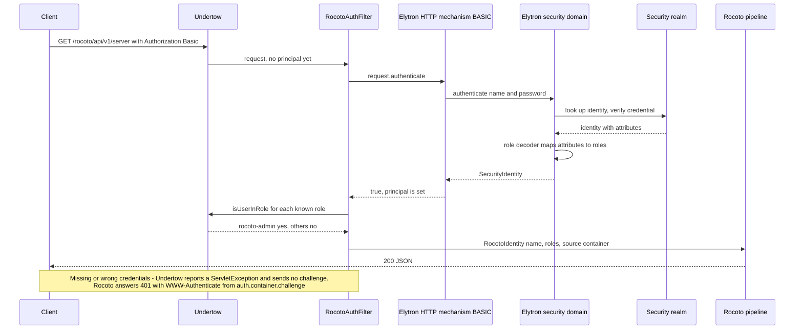
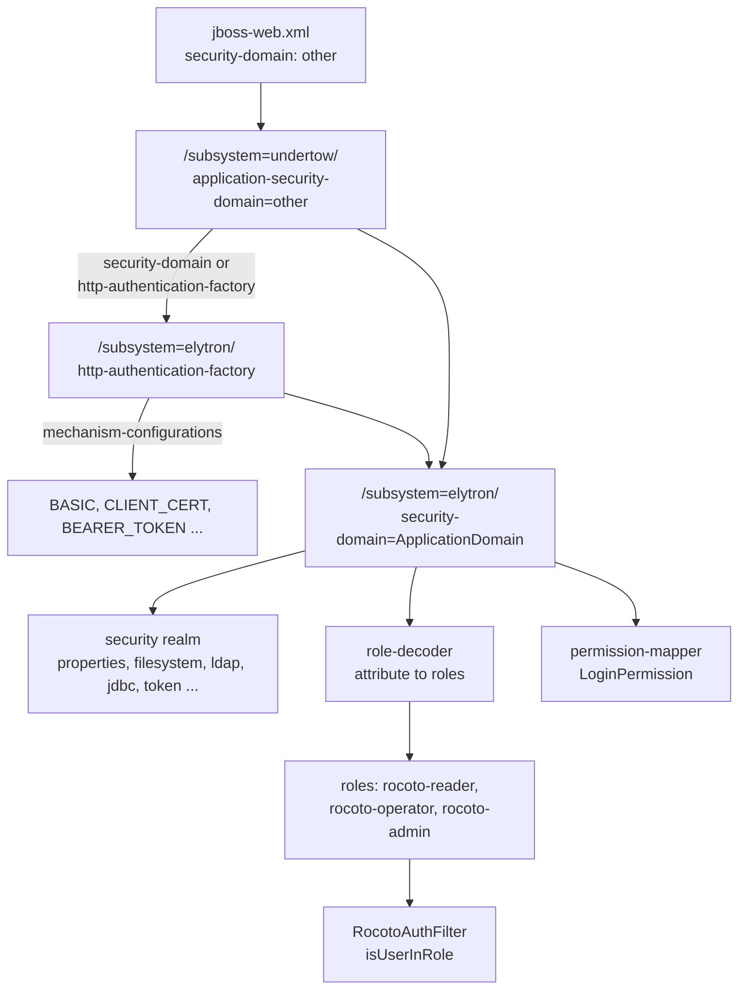

# 10. WildFly and Elytron

WildFly 27 and later and JBoss EAP 8 have exactly one security framework: Elytron. The legacy
`security` subsystem (PicketBox, JAAS login modules, `security-domain` in the `security` subsystem)
is gone. This chapter explains how Rocoto plugs into Elytron, provides CLI scripts for the common
setups and covers the WildFly specifics that influence what Rocoto can see.

> **What is verified and what is not.** Besides the integration tests against embedded Tomcat, a
> CI job ("Smoke test on a real WildFly (Elytron)", `ci/wildfly/smoke-test.sh` and
> `ci/wildfly/Dockerfile`) deploys `rocoto.war` into the official WildFly container image - it ran
> on WildFly 41.0.1.Final - and verifies: detection of the `wildfly` adapter; `auth.mode: chain`
> with an Elytron user created by `add-user.sh -a -u <user> -p <password> -g rocoto-admin` in the
> default `ApplicationRealm` / application-security-domain `other` (the group becomes the Rocoto
> role), next to a built-in Basic user and an API token; the product version read from
> `jboss.as:management-root=server`; the `deployments`, `datasources` (`ExampleDS`), `sessions`
> and `threadpools` (io worker `default`) resources; the policy including the built-in deny list
> for `jboss.as:subsystem=elytron`; `415` for form posts; `jvm_*` and `wildfly_*` metrics; a
> Jolokia read and the rejection of proxy mode; SSE streaming. The statements about the default
> configuration in this chapter rest on that test.
>
> The CLI scripts under [`scripts/wildfly/`](scripts/wildfly/) - dedicated realm and domain, mTLS,
> OIDC, RBAC, OCSP - are recipes written against the WildFly 27+ management model; review and adapt
> them before use. `ci/wildfly/cli-scripts-test.sh` executes them against a real WildFly (40.0.1.Final
> at the time of writing) with an `openssl ocsp` responder and Keycloak 26.

## Which mode?

| `auth.mode` | Who authenticates | Use when |
|---|---|---|
| `builtin` (default) | Rocoto: `rocoto-users.yaml`, API tokens, JWT, its own mTLS mapping | You want the same setup on every server type, or API tokens with MBean scope |
| `container` | Elytron only | Users and roles already live in Elytron (LDAP, database, Keycloak, certificates) |
| `chain` | Rocoto first; requests without Rocoto credentials go to Elytron | Humans log in through Elytron, machines use Rocoto API tokens |

In `chain` mode the order is: a `Bearer rct_...` token, a JWT (if enabled) or Basic credentials of
a user that exists in `rocoto-users.yaml` are handled by Rocoto. Basic credentials of a user
Rocoto does not know, and requests without credentials, are passed to Elytron.

This only works because the shipped `jboss-web.xml` switches Undertow's **proactive
authentication** off. With the Undertow default (on), Elytron evaluates an `Authorization: Basic`
header *before* Rocoto's filter runs and answers `401` for users that exist only in Rocoto's own
user store - built-in Basic users could not log in in `chain` or `builtin` mode. With
`<proactive-authentication>false</proactive-authentication>` nothing is authenticated until
Rocoto calls `HttpServletRequest.authenticate()` itself. This was found, and is now guarded, by
the WildFly smoke test in CI.

## How a request reaches Elytron

Rocoto's `web.xml` contains **no** `<security-constraint>`. The authentication filter calls
`HttpServletRequest.authenticate()` itself, which triggers the mechanism Elytron has configured
for the deployment. Afterwards the filter asks `isUserInRole()` for every role the policy knows
(`rocoto-reader`, `rocoto-operator`, `rocoto-admin`, plus any role named in `policy.readRoles` or
in a rule) and builds the Rocoto identity from the answers.



Undertow reports a missing or failed login from `request.authenticate()` as a `ServletException`
and does not write a challenge of its own. Rocoto catches the exception and answers `401` with a
`WWW-Authenticate` header taken from `auth.container.challenge` (default
`Basic realm="Rocoto", charset="UTF-8"`), so `curl -u` and browsers prompt as usual. If
credentials were presented and Elytron rejected them, Rocoto also writes an audit record:
outcome `AUTH_FAILED`, `auth` `container`, reason `rejected by the application server's security
domain`. When the Elytron mechanism is not BASIC, set a matching challenge:

```yaml
auth:
  mode: container
  container:
    challenge: 'Bearer realm="Rocoto"'
```

### The object chain

The shipped `WEB-INF/jboss-web.xml` names the security domain `other` and switches proactive
authentication off:

```xml
<jboss-web xmlns="http://www.jboss.com/xml/ns/javaee">
  <context-root>/rocoto</context-root>
  <security-domain>other</security-domain>
  <proactive-authentication>false</proactive-authentication>
</jboss-web>
```

That name does **not** refer to an Elytron security domain directly. It is resolved through the
Undertow subsystem:



In the default `standalone.xml`, `application-security-domain=other` points to the Elytron domain
`ApplicationDomain`, which uses `ApplicationRealm` (the files `application-users.properties` and
`application-roles.properties`) and the role decoder `groups-to-roles`. That a group assigned
with `add-user.sh -a -g rocoto-admin` arrives as the Rocoto role `rocoto-admin` is verified by the
CI smoke test on the official WildFly image.

**The requirement is always the same, whatever the realm:** after the role decoder (and optional
role mappers) have run, the identity must carry roles literally named `rocoto-reader`,
`rocoto-operator` or `rocoto-admin` (or the custom role names your policy uses). If your directory
uses other group names, translate them in Elytron with a `mapped-role-mapper`:

```
/subsystem=elytron/mapped-role-mapper=rocotoRoleMap:add(keep-mapped=false, keep-non-mapped=true, \
    role-map={"ops-admins" => ["rocoto-admin"], "ops-readonly" => ["rocoto-reader"]})
/subsystem=elytron/security-domain=ApplicationDomain:write-attribute(name=role-mapper, value=rocotoRoleMap)
```

## Quick start with the default domain

For a first test you need no CLI at all. This is the path the CI smoke test exercises (there
with `auth.mode: chain`):

```bash
$JBOSS_HOME/bin/add-user.sh -a -u ada -p 'a-long-passphrase' -g rocoto-admin
```

```yaml
# standalone/configuration/rocoto.yaml
auth:
  mode: container
```

```bash
curl -s -u ada https://localhost:8443/rocoto/api/v1/server
```

`"caller"` in the response must show `"authenticatedBy": "container"` and the role. If the role
list is empty, the role decoder does not produce Rocoto's role names (see
[chapter 12](12-troubleshooting.md)).

## A dedicated domain with BASIC

A separate domain keeps Rocoto's operators apart from the users of your applications.
Script: [`scripts/wildfly/setup-basic.cli`](scripts/wildfly/setup-basic.cli).

```
# Review and adapt before use; written against the WildFly 27+ management model
batch
/subsystem=elytron/filesystem-realm=rocotoRealm:add(path=rocoto-realm, relative-to=jboss.server.config.dir)
/subsystem=elytron/simple-role-decoder=rocotoRoleDecoder:add(attribute=Roles)
/subsystem=elytron/security-domain=rocotoDomain:add( \
    realms=[{realm=rocotoRealm, role-decoder=rocotoRoleDecoder}], \
    default-realm=rocotoRealm, \
    permission-mapper=default-permission-mapper)
/subsystem=elytron/http-authentication-factory=rocotoHttpAuth:add( \
    http-server-mechanism-factory=global, \
    security-domain=rocotoDomain, \
    mechanism-configurations=[{ \
        mechanism-name=BASIC, \
        mechanism-realm-configurations=[{realm-name=Rocoto}]}])
/subsystem=undertow/application-security-domain=rocoto:add( \
    http-authentication-factory=rocotoHttpAuth, \
    override-deployment-config=true)
run-batch

/subsystem=elytron/filesystem-realm=rocotoRealm:add-identity(identity=ada)
/subsystem=elytron/filesystem-realm=rocotoRealm:set-password(identity=ada, clear={password="CHANGE-ME"})
/subsystem=elytron/filesystem-realm=rocotoRealm:add-identity-attribute(identity=ada, name=Roles, value=[rocoto-admin])
reload
```

Notes:

- `default-permission-mapper` exists in the default configurations and grants the
  `LoginPermission`. A domain without a permission mapper authenticates nobody.
- `set-password(... clear=...)` stores the password in clear text inside the realm directory.
  Use a hashed form (`bcrypt={...}`) or an encrypted filesystem realm; the script file contains
  the details. Swap the realm for `ldap-realm`, `jdbc-realm` etc. as needed; nothing else changes.
- `override-deployment-config=true` makes the mechanisms of the factory win over the
  `<login-config>` of Rocoto's `web.xml` (BASIC). It matters as soon as the factory offers
  something else than BASIC.
- Instead of `http-authentication-factory=...` you can reference the domain directly
  (`application-security-domain=rocoto:add(security-domain=rocotoDomain)`); the mechanism is then
  taken from `web.xml`, i.e. BASIC.

### Pointing Rocoto at another security domain

The domain name is part of the WAR (`WEB-INF/jboss-web.xml`). A **deployment overlay** replaces
that file on the server without rebuilding the WAR. Scripts:
[`scripts/wildfly/rocoto-overlay.cli`](scripts/wildfly/rocoto-overlay.cli),
[`scripts/wildfly/jboss-web-rocoto-domain.xml`](scripts/wildfly/jboss-web-rocoto-domain.xml).

```xml
<!-- /path/to/jboss-web.xml -->
<jboss-web xmlns="http://www.jboss.com/xml/ns/javaee">
  <context-root>/rocoto</context-root>
  <security-domain>rocoto</security-domain>
  <!-- MUST be kept: otherwise Elytron evaluates Authorization headers before Rocoto's filter -->
  <proactive-authentication>false</proactive-authentication>
</jboss-web>
```

The overlay replaces the **whole** file, so it must repeat
`<proactive-authentication>false</proactive-authentication>`. Without it, built-in Basic users
(`chain` and `builtin` mode) are answered with `401` by Elytron before Rocoto sees the request.

```
deployment-overlay add --name=rocoto-security-domain \
    --content=/WEB-INF/jboss-web.xml=/path/to/jboss-web.xml \
    --deployments=rocoto.war \
    --redeploy-affected
```

The overlay survives redeployments of `rocoto.war` as long as the deployment name stays the same.
The same mechanism changes the context root. Alternatives: map the name `other` to your domain
(affects all deployments that use `other`), or edit the file inside the WAR.

## Client certificates (mTLS) through Elytron

Script: [`scripts/wildfly/setup-mtls.cli`](scripts/wildfly/setup-mtls.cli). The essential
resources:

```
# Review and adapt before use; written against the WildFly 27+ management model
/subsystem=elytron/key-store=rocotoServerKS:add(path=server.p12, relative-to=jboss.server.config.dir, \
    type=PKCS12, credential-reference={clear-text="CHANGE-ME"})
/subsystem=elytron/key-manager=rocotoKM:add(key-store=rocotoServerKS, credential-reference={clear-text="CHANGE-ME"})
/subsystem=elytron/key-store=rocotoClientCaTS:add(path=client-ca.p12, relative-to=jboss.server.config.dir, \
    type=PKCS12, credential-reference={clear-text="CHANGE-ME"})

# OCSP for client certificates; hard fail
/subsystem=elytron/trust-manager=rocotoTM:add(key-store=rocotoClientCaTS, ocsp={}, soft-fail=false)

/subsystem=elytron/server-ssl-context=rocotoSSC:add(key-manager=rocotoKM, trust-manager=rocotoTM, \
    want-client-auth=true, protocols=[TLSv1.3, TLSv1.2])
/subsystem=undertow/server=default-server/https-listener=https:write-attribute(name=ssl-context, value=rocotoSSC)

/subsystem=elytron/x500-attribute-principal-decoder=rocotoCnDecoder:add(attribute-name=CN, maximum-segments=1)
/subsystem=elytron/filesystem-realm=rocotoCertRealm:add(path=rocoto-cert-realm, relative-to=jboss.server.config.dir)
/subsystem=elytron/simple-role-decoder=rocotoCertRoleDecoder:add(attribute=Roles)
/subsystem=elytron/security-domain=rocotoCertDomain:add( \
    realms=[{realm=rocotoCertRealm, role-decoder=rocotoCertRoleDecoder}], default-realm=rocotoCertRealm, \
    permission-mapper=default-permission-mapper, principal-decoder=rocotoCnDecoder)

/subsystem=elytron/configurable-http-server-mechanism-factory=rocotoCertMechFactory:add( \
    http-server-mechanism-factory=global, \
    properties={org.wildfly.security.http.skip-certificate-verification=true})
/subsystem=elytron/http-authentication-factory=rocotoCertHttpAuth:add( \
    http-server-mechanism-factory=rocotoCertMechFactory, security-domain=rocotoCertDomain, \
    mechanism-configurations=[{mechanism-name=CLIENT_CERT}])
/subsystem=undertow/application-security-domain=rocoto:add( \
    http-authentication-factory=rocotoCertHttpAuth, override-deployment-config=true)

/subsystem=elytron/filesystem-realm=rocotoCertRealm:add-identity(identity=ops-gateway)
/subsystem=elytron/filesystem-realm=rocotoCertRealm:add-identity-attribute(identity=ops-gateway, name=Roles, value=[rocoto-operator])
```

- `want-client-auth=true` requests a certificate but lets clients without one continue, so other
  mechanisms remain usable on the same listener. `need-client-auth=true` fails the handshake
  without a certificate, for every application on that listener.
- The trust manager validates the chain and its revocation status (`ocsp={}`: responder URL from
  the certificate; `certificate-revocation-list={...}` for CRLs) during the TLS handshake. Details
  in [chapter 13](13-tls-and-ocsp.md).
- The principal decoder turns the subject DN into the principal name (here the CN); the realm
  provides the roles for that name.
- `skip-certificate-verification` tells the `CLIENT_CERT` mechanism not to ask the realm to verify
  the certificate again; a filesystem realm cannot do that. The alternative is a
  `key-store-realm` that contains every accepted client certificate, combined with a role mapper.
- To offer certificates *and* passwords, list both mechanisms in `mechanism-configurations`
  (`CLIENT_CERT` first, then `BASIC`).

In `builtin` mode Rocoto can map client certificates itself (`auth.builtin.mtls`), including its
own revocation check. The listener still has to request the certificate (`want-client-auth`),
because the handshake is Undertow's. See [chapter 13](13-tls-and-ocsp.md#b-revocation-of-client-certificates).

## OpenID Connect / Keycloak

There are two ways to accept OIDC access tokens. Both are bearer-only: Rocoto is an API, it never
redirects to a login page.

### Option A: Rocoto validates the JWT (recommended)

Works identically on every server and needs no server configuration:

```yaml
auth:
  mode: builtin              # or chain
  builtin:
    jwt:
      enabled: true
      issuer: https://idp.example.com/realms/ops
      audience: rocoto
      jwksUrl: https://idp.example.com/realms/ops/protocol/openid-connect/certs
      nameClaim: preferred_username
      rolesClaim: realm_access.roles
      roleMapping: { ops-admin: rocoto-admin, ops-viewer: rocoto-reader }
```

`issuer` and `audience` are mandatory and verified, as are signature (RSA or EC keys), `exp` and
`nbf`. The JWKS download uses `tls.outbound` (revocation checking). With Keycloak, add an audience
mapper to the client so that `aud` contains `rocoto`. See
[chapter 3](03-authentication.md) and the [configuration reference](../reference/configuration.md).

### Option B: `elytron-oidc-client`

Script: [`scripts/wildfly/setup-oidc.cli`](scripts/wildfly/setup-oidc.cli).

```
# Review and adapt before use; written against the WildFly 27+ management model
/subsystem=elytron-oidc-client/secure-deployment=rocoto.war:add( \
    provider-url="https://idp.example.com/realms/ops", \
    client-id=rocoto, \
    bearer-only=true, \
    ssl-required=ALL, \
    principal-attribute=preferred_username, \
    use-resource-role-mappings=false, \
    verify-token-audience=true)
reload
```

```yaml
auth:
  mode: container
```

- The subsystem activates the OIDC mechanism for the named deployment and installs its own
  (virtual) security domain. Roles are taken from `realm_access.roles`, or from the client roles
  of `rocoto` with `use-resource-role-mappings=true`. They must be named like Rocoto's roles;
  there is no mapping step on this path.
- The shipped `jboss-web.xml` also names a security domain (`other`). If the OIDC mechanism does
  not become active for the deployment, remove the `<security-domain>` element with a deployment
  overlay so that only the subsystem configuration applies - but keep
  `<proactive-authentication>false</proactive-authentication>` in the overlay file.
- Set `auth.container.challenge: 'Bearer realm="Rocoto"'` so that the `401` Rocoto writes for
  requests without a token names the right scheme.
- Do not combine option B with `chain` mode and Rocoto JWT validation; one component should own
  bearer tokens. `chain` with Rocoto API tokens (`rct_...`) is fine: those are consumed by Rocoto
  before Elytron sees the request.

## Management RBAC and the JMX subsystem

On WildFly, the interesting MBeans (`jboss.as:*`, `jboss.as.expr:*`) are a JMX facade of the
management model, provided by the `jmx` subsystem (`expose-model=resolved` and
`expose-model=expression`, both present in the default configurations). Access to them is
authorized **twice**:

1. by Rocoto's policy, and
2. by WildFly's management access control, for the identity of the calling thread.

With the default `provider=simple` the second check does not restrict in-VM callers. With
`provider=rbac`, WildFly maps the caller to management roles (`Monitor`, `Operator`,
`Maintainer`, `Administrator`, ...) and may refuse the call. Rocoto reports such a refusal as
`403` with the text `The application server denied access to this MBean`. A refused read is
audited as `DENIED` with the reason `denied by the application server`; for `write` and `exec`
the audit record has the outcome `FAILED`.

```
/core-service=management/access=authorization:write-attribute(name=provider, value=rbac)
/core-service=management/access=authorization/role-mapping=Monitor:add
/core-service=management/access=authorization/role-mapping=Monitor/include=user-rita:add(name=rita, type=USER)
```

Things to know:

- Whether the *web* identity is recognized by the *management* access control depends on how the
  two Elytron domains are related (same domain, or trust between them through
  `trusted-security-domains` / `outflow-security-domains`). If they are unrelated, WildFly sees the
  in-VM call without a management identity. Test with a reader account and a `jboss.as:*`
  attribute before relying on RBAC for separation.
- `/subsystem=jmx:write-attribute(name=non-core-mbean-sensitivity, value=true)` makes RBAC treat
  MBeans that do not come from the management model (`java.lang:*`, application MBeans) as
  sensitive. The default `false` leaves them readable to all management roles.
- In `builtin` mode Elytron never sees Rocoto's users. Calls then run with whatever identity the
  request thread has, normally none.
- Whatever WildFly decides, Rocoto's built-in deny list always blocks `write`/`exec` on
  `jboss.as[.expr]:subsystem=elytron,*`, `jboss.as[.expr]:core-service=management,*` and
  `jboss.as:core-service=vault`.

Script with these settings (commented out by default):
[`scripts/wildfly/setup-rbac-and-statistics.cli`](scripts/wildfly/setup-rbac-and-statistics.cli).

### Identity propagation for streaming

Subscriptions ([chapter 7](07-streaming.md)) are polled by Rocoto's own scheduler threads, not by
the request thread. So that WildFly's access control keeps seeing the subscriber, the WildFly
adapter captures the current Elytron `SecurityIdentity` when the subscription is created and runs
every poll inside `SecurityIdentity.runAs(...)`.

Rocoto has no compile-time dependency on Elytron. It accesses the API reflectively, which requires
the module to be visible to the deployment. The WAR therefore ships
`WEB-INF/jboss-deployment-structure.xml`:

```xml
<jboss-deployment-structure xmlns="urn:jboss:deployment-structure:1.3">
  <deployment>
    <dependencies>
      <module name="org.wildfly.security.elytron" optional="true"/>
    </dependencies>
  </deployment>
</jboss-deployment-structure>
```

The dependency is optional: if the module cannot be loaded, subscriptions still work, but polls
run without the caller's Elytron identity. On other servers the file is ignored.

## Statistics: giving Rocoto something to show

WildFly does not collect pool and web statistics by default. Without them
`/api/v1/resources/datasources` shows only `name`, `jndiName`, `enabled` and `maxConnections`
(the data source attribute `maxPoolSize`), session counters are
missing, and the `wildfly` metric profile yields few samples.

```
/subsystem=datasources/data-source=ExampleDS:write-attribute(name=statistics-enabled, value=true)
/subsystem=undertow:write-attribute(name=statistics-enabled, value=true)
reload
```

These two commands are verified: the CI smoke test applies them to the official WildFly image
while building it, offline through an embedded server, and then checks the `datasources`
resource and the `wildfly_*` metrics:

```bash
$JBOSS_HOME/bin/jboss-cli.sh --commands="embed-server --std-out=echo,\
/subsystem=undertow:write-attribute(name=statistics-enabled,value=true),\
/subsystem=datasources/data-source=ExampleDS:write-attribute(name=statistics-enabled,value=true),\
stop-embedded-server"
```

Repeat the first line for every (XA) data source. The default configurations define these
attributes as expressions, so a single JVM option enables all of them:

```bash
# bin/standalone.conf
JAVA_OPTS="$JAVA_OPTS -Dwildfly.statistics-enabled=true"
```

What the WildFly adapter reads:

| Resource kind | MBeans | Needs statistics |
|---|---|---|
| `datasources` | `jboss.as:subsystem=datasources,data-source=*` and `xa-data-source=*` (`jndiName`, `enabled`, `maxConnections` from `maxPoolSize`), plus `...,statistics=pool` (`activeConnections`, `idleConnections`, `availableConnections` from `availableCount`, `waitingThreads`, `maxUsedConnections`) | pool numbers: yes |
| `threadpools` | `jboss.as:subsystem=io,worker=*` | no |
| `deployments` | `jboss.as:deployment=*` | no |
| `sessions` | `jboss.as:deployment=*,subsystem=undertow` | yes (Undertow) |

## Built-in mode on WildFly

`auth.mode: builtin` works on WildFly like anywhere else, with four things to keep in mind:

1. **The security domain reference still has to resolve.** `jboss-web.xml` names `other`; if your
   configuration has no `application-security-domain=other`, the deployment fails. Either keep
   that mapping or use the overlay shown above. In `builtin` mode Elytron is never asked to
   authenticate, so the domain's content is irrelevant.
2. **TLS is judged by `request.isSecure()`.** Credentials are only accepted on the HTTPS listener.
   Behind a TLS-terminating reverse proxy, set `proxy-address-forwarding=true` on the HTTP
   listener so that Undertow evaluates `X-Forwarded-Proto`, and make sure only the proxy can
   reach that listener:

   ```
   /subsystem=undertow/server=default-server/http-listener=default:write-attribute(name=proxy-address-forwarding, value=true)
   ```

3. **Configuration location.** Rocoto reads `${jboss.server.config.dir}/rocoto.yaml`, i.e.
   `standalone/configuration/rocoto.yaml`; `rocoto-users.yaml` is resolved relative to that
   directory - also when there is no `rocoto.yaml` at all.
4. **Proactive authentication stays off.** The shipped `jboss-web.xml` contains
   `<proactive-authentication>false</proactive-authentication>`. Without it Elytron would reject
   the Basic credentials of built-in users before Rocoto's filter runs. Keep the element in any
   overlay that replaces the file.

## Next

[11. Security hardening](11-security-hardening.md)
