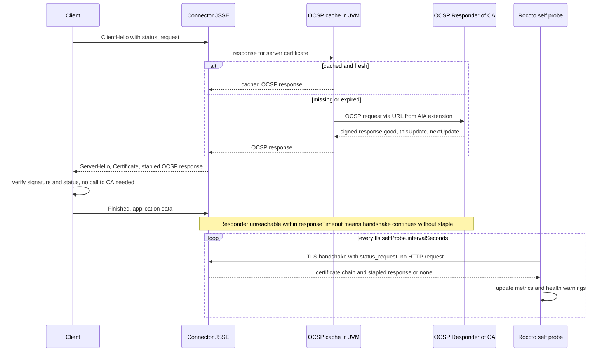
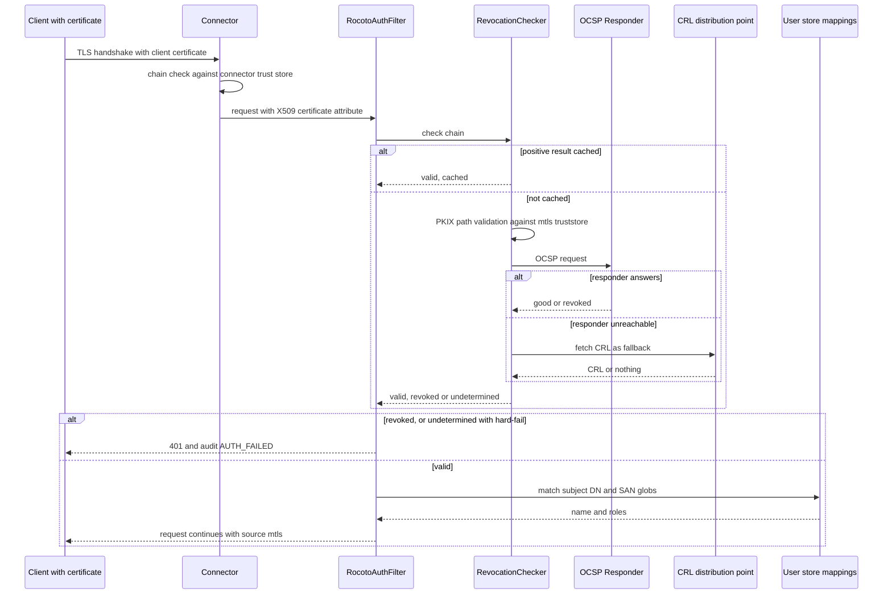

# 13. TLS, certificate revocation and OCSP stapling

Rocoto refuses credentials on connections that are not TLS-protected, so every production
installation has an HTTPS listener in front of it. This chapter covers the revocation side of
TLS: OCSP stapling for the server certificate, revocation checking for client certificates, and
revocation checking for the connections Rocoto opens itself.

## Who does what

One fact first, because it determines everything else:

> **The TLS handshake is performed by the application server's connector** (Undertow, Coyote,
> Grizzly) before any web application sees the request. A WAR cannot staple an OCSP response
> to a handshake it does not take part in. Rocoto therefore does not staple. It tells you how to
> **enable** stapling in the server, **verifies** from the outside that it works, and
> **monitors** it continuously.

| Concern | Done by | Rocoto's part |
|---|---|---|
| (a) Stapling the server certificate's OCSP response | JVM (JSSE) inside the server's connector | `tls check` tool, self probe, metrics, health warnings |
| (b) Revocation of client certificates (mTLS) | `container` mode: the server (Elytron trust manager, Tomcat connector). `builtin` mode: **Rocoto** | `auth.builtin.mtls.revocation` |
| (c) Revocation of servers Rocoto connects to (JWKS, OTLP) | **Rocoto** | `tls.outbound.*` |

## (a) Enabling OCSP stapling on the server

### What stapling is

Without stapling, a careful client has to ask the CA's OCSP responder whether the server
certificate is still valid: an extra connection, a privacy leak, and a soft spot, because most
clients give up silently when the responder is unreachable. With stapling the *server* fetches
the signed OCSP response periodically and attaches ("staples") it to the handshake.



### Prerequisites

- The server certificate contains an OCSP responder URL in its *Authority Information Access*
  (AIA) extension. Check with:

  ```bash
  openssl x509 -in server.crt -noout -ocsp_uri
  ```

  No output means the CA does not offer OCSP for this certificate (some public CAs have stopped
  doing so and rely on CRLs and short lifetimes; internal CAs often need the responder to be
  configured first). Stapling is then impossible unless you operate a responder and point the
  JVM to it with `jdk.tls.stapling.responderURI`.
- The key store entry contains the full chain (leaf and issuing CA). The issuer certificate is
  needed to build the OCSP request.
- The server can reach the responder by HTTP, directly or through `-Dhttp.proxyHost`.
- The connector uses the JDK's TLS implementation (JSSE). OpenSSL-based connectors ignore the
  `jdk.tls.*` properties.

### The JSSE system properties

Server-side stapling is **off by default** in the JDK and switched on with one system property:

```
-Djdk.tls.server.enableStatusRequestExtension=true
```

Tuning properties (JDK defaults in parentheses):

| Property | Meaning |
|---|---|
| `jdk.tls.stapling.responseTimeout` (`5000`) | Milliseconds the handshake waits for a response, from cache or responder. After that the handshake continues **without** a staple |
| `jdk.tls.stapling.cacheSize` (`256`) | Maximum number of cached responses; `0` means unbounded |
| `jdk.tls.stapling.cacheLifetime` (`3600`) | Maximum seconds a response is cached; a `nextUpdate` earlier than that wins. `0` disables the lifetime limit |
| `jdk.tls.stapling.responderURI` (none) | Responder to use for certificates **without** an AIA responder URL |
| `jdk.tls.stapling.responderOverride` (`false`) | `true`: use `responderURI` even if the certificate has its own URL |
| `jdk.tls.stapling.ignoreExtensions` (`false`) | `true`: do not forward OCSP extensions from the client's `status_request` to the responder |

These are JDK properties, documented in the JSSE Reference Guide; they behave the same on every
server below.

### WildFly / JBoss EAP

`bin/standalone.conf`:

```bash
JAVA_OPTS="$JAVA_OPTS -Djdk.tls.server.enableStatusRequestExtension=true"
```

Listener configuration, script
[`scripts/wildfly/setup-tls-ocsp.cli`](scripts/wildfly/setup-tls-ocsp.cli):

```
# Review and adapt before use; written against the WildFly 27+ management model
batch
/subsystem=elytron/key-store=rocotoTlsKS:add(path=server.p12, relative-to=jboss.server.config.dir, \
    type=PKCS12, credential-reference={clear-text="CHANGE-ME"})
/subsystem=elytron/key-manager=rocotoTlsKM:add(key-store=rocotoTlsKS, \
    credential-reference={clear-text="CHANGE-ME"})
/subsystem=elytron/server-ssl-context=rocotoTlsSSC:add(key-manager=rocotoTlsKM, \
    protocols=[TLSv1.3, TLSv1.2])
/subsystem=undertow/server=default-server/https-listener=https:write-attribute(name=ssl-context, value=rocotoTlsSSC)
run-batch
reload
```

Elytron's `server-ssl-context` has no stapling attribute of its own; it wraps a JSSE `SSLContext`,
and the JVM property applies to it. If the context is configured with the OpenSSL provider
(`providers` pointing to `openssl`, WildFly OpenSSL), the JVM properties have no effect. Use a
credential store instead of `clear-text` passwords.

### Tomcat

Files: [`scripts/tomcat/setenv.sh`](scripts/tomcat/setenv.sh) (Windows: [`setenv.bat`](scripts/tomcat/setenv.bat)),
[`scripts/tomcat/server-ocsp-snippet.xml`](scripts/tomcat/server-ocsp-snippet.xml).

```bash
# $CATALINA_BASE/bin/setenv.sh
CATALINA_OPTS="$CATALINA_OPTS -Djdk.tls.server.enableStatusRequestExtension=true"
export CATALINA_OPTS
```

```xml
<!-- $CATALINA_BASE/conf/server.xml -->
<Connector port="8443"
           protocol="org.apache.coyote.http11.Http11NioProtocol"
           sslImplementationName="org.apache.tomcat.util.net.jsse.JSSEImplementation"
           SSLEnabled="true" scheme="https" secure="true" maxThreads="150">
  <SSLHostConfig protocols="TLSv1.3,TLSv1.2">
    <Certificate certificateKeystoreFile="conf/server.p12"
                 certificateKeystoreType="PKCS12"
                 certificateKeystorePassword="CHANGE-ME"
                 type="RSA" />
  </SSLHostConfig>
</Connector>
```

`sslImplementationName` pins the JSSE implementation. Without it, Tomcat selects the OpenSSL
implementation for NIO connectors when the Tomcat Native library is present, and the `jdk.tls.*`
properties are ignored. **OpenSSL alternative:** connectors running on OpenSSL (Tomcat Native /
APR heritage, or the FFM-based OpenSSL integration of recent Tomcat versions) handle TLS in native
code. Whether and how they staple depends on the Tomcat and Tomcat Native versions; consult the
SSL how-to of your Tomcat version. Whatever you choose, verify the result with `tls check`.

### Payara / GlassFish

```bash
asadmin create-jvm-options "-Djdk.tls.server.enableStatusRequestExtension=true"
asadmin restart-domain
```

Payara's HTTP listeners (Grizzly) use JSSE, so the same JDK mechanism applies. Tuning properties
are added the same way; a colon inside a value must be escaped for `asadmin`
(`"-Djdk.tls.stapling.responderURI=http\://ocsp.example.com"`).

## (b) Revocation of client certificates

Stapling concerns the *server* certificate. With mutual TLS the server has to check the *client's*
certificate as well, and nobody staples that for it: the server has to ask the CA.

### Container mode: the server checks

**WildFly / Elytron:** revocation is a property of the `trust-manager` used by the
`server-ssl-context` ([chapter 10](10-wildfly-elytron.md#client-certificates-mtls-through-elytron),
[`scripts/wildfly/setup-mtls.cli`](scripts/wildfly/setup-mtls.cli)):

```
# OCSP, responder URL taken from the client certificate (AIA)
/subsystem=elytron/trust-manager=rocotoTM:add(key-store=rocotoClientCaTS, ocsp={}, soft-fail=false)

# OCSP with a fixed responder
/subsystem=elytron/trust-manager=rocotoTM:write-attribute(name=ocsp, value={responder="http://ocsp.example.com"})

# CRL file instead of, or in addition to, OCSP
/subsystem=elytron/trust-manager=rocotoTM:write-attribute(name=certificate-revocation-list, \
    value={path=client-ca.crl, relative-to=jboss.server.config.dir})
```

If both are configured, OCSP is preferred unless `ocsp={prefer-crls=true}`. With
`soft-fail=true` a certificate whose status cannot be determined is accepted. A revoked client
fails the TLS handshake and never reaches Rocoto.

**Tomcat:** `certificateVerification="required"` or `"optional"` with `truststoreFile`, plus
`revocationEnabled="true"` (and optionally `certificateRevocationListFile`) on `SSLHostConfig`.
This uses the JDK's default PKIX revocation checking, which consults OCSP only when the security
property `ocsp.enable=true` is set and downloads CRLs from distribution points only with
`-Dcom.sun.security.enableCRLDP=true`.

### Built-in mode: Rocoto checks

With `auth.builtin.mtls.enabled: true` Rocoto authenticates client certificates itself and maps
them to roles through the `certificates:` section of `rocoto-users.yaml`
([chapter 3](03-authentication.md)).

```yaml
auth:
  mode: builtin
  builtin:
    mtls:
      enabled: true
      revocation: hard-fail            # off | soft-fail | hard-fail
      truststore: /etc/rocoto/client-ca.p12
      truststorePassword: ${file:/run/secrets/rocoto-truststore-password}
      truststoreType: PKCS12
      ocspResponder: null              # e.g. http://ocsp.internal.example.com
      cacheSeconds: 300
```

| Key | Meaning |
|---|---|
| `revocation: hard-fail` (default) | Revoked certificates are rejected, **and** so are certificates whose status cannot be determined (responder down, no OCSP URL and no CRL) |
| `revocation: soft-fail` | Revoked certificates are rejected; an undetermined status is tolerated. Availability over strictness |
| `revocation: off` | Chain validation only. Not recommended |
| `truststore`, `truststorePassword`, `truststoreType` | Trust anchors for client certificates. Default is the JDK trust store, which trusts every public CA; use a dedicated store containing only your client CA |
| `ocspResponder` | Overrides the responder URL of the certificates |
| `cacheSeconds` | How long a **positive** result is reused for the same certificate (issuer and serial number). Failures are never cached. This also bounds how long a freshly revoked certificate keeps working |

The connector still has to *request* the certificate, because the handshake belongs to it:
`want-client-auth=true` on Elytron's `server-ssl-context`, `certificateVerification="optional"` on
Tomcat, `client-auth=want` on Payara. The connector needs a trust store with the client CA for
that, but it does not need revocation checking of its own; Rocoto validates the complete chain
again with its own trust anchors, then checks revocation.



Details:

- The implementation uses the JDK's `PKIXRevocationChecker`: OCSP first, CRL as fallback. The
  JDK downloads CRLs from the certificate's distribution points only when the JVM runs with
  `-Dcom.sun.security.enableCRLDP=true`; without it the fallback has nothing to fall back on.
- A rejected certificate is reported to the client as `401`. The audit record says why:
  `client certificate rejected: certificate revoked`, `... revocation status could not be
  determined`, `... certificate path invalid: <detail>`, or `no certificate mapping matches`.
- Client certificates are evaluated only if the request carries no `Authorization` header.
- OCSP requests of the JVM honor `-Dhttp.proxyHost` / `-Dhttp.proxyPort`.

## (c) Outbound connections: JWKS and OTLP

Rocoto opens TLS connections in two places: downloading the JWKS document for JWT validation and
pushing metrics to an OTLP collector. Both use one `SSLContext` configured under `tls.outbound`:

```yaml
tls:
  outbound:
    revocation: soft-fail      # off | soft-fail | hard-fail
    requireStapling: false
    truststore: null           # default: the JDK trust store
    truststorePassword: null
```

- The JDK TLS *client* requests a stapled response by default
  (`jdk.tls.client.enableStatusRequestExtension`). With `revocation` other than `off`, a stapled
  response is validated during the handshake; without a staple the JDK queries OCSP itself, then
  CRLs.
- `soft-fail` (default): a revoked server certificate aborts the connection, an unreachable
  responder does not. `hard-fail`: an undetermined status aborts it too. Choose `hard-fail` only
  if the responders of your identity provider's CA are reliably reachable from the server;
  otherwise a responder outage stops JWT key refresh and metric export.
- `requireStapling: true` additionally rejects servers that do not staple at all ("must-staple"
  behavior enforced by the client). The error reads
  `Server did not staple an OCSP response (tls.outbound.requireStapling)`. Enable it only when
  you control the peer.
- `truststore` is useful when the identity provider or collector uses an internal CA.
- `http://` endpoints are refused unless explicitly allowed (`metrics.otlp.allowInsecure`; for
  `jwksUrl` only with `auth.allowInsecureTransport`, i.e. never in production).

## (d) Monitoring

### One-off check: `rocoto-tools tls check`

```bash
java -jar rocoto-tools.jar tls check app.example.com:8443
```

The tool performs a handshake (with SNI, requesting a stapled response), prints what the server
presents and exits. It accepts any certificate on purpose, so it also reports on expired or
untrusted chains. The port defaults to 443.

Stapling works:

```
Connected to app.example.com:8443 using TLSv1.3 / TLS_AES_256_GCM_SHA384

Certificate chain:
  [0] CN=app.example.com,O=Example,C=DE
      issuer:  CN=Example Issuing CA 1,O=Example,C=DE
      expires: 2026-11-04T12:00:00Z  (248 days)
  [1] CN=Example Issuing CA 1,O=Example,C=DE
      issuer:  CN=Example Root CA,O=Example,C=DE
      expires: 2031-05-01T00:00:00Z  (1887 days)

OCSP stapling: YES
  response status:    successful
  certificate status: good
  produced at:        2026-03-01T06:00:12Z
  this update:        2026-03-01T06:00:00Z
  next update:        2026-03-08T06:00:00Z
```

Stapling does not work:

```
OCSP stapling: NO - the server did not staple an OCSP response.
  JSSE based connectors (WildFly/Undertow, Tomcat NIO): start the JVM with
    -Djdk.tls.server.enableStatusRequestExtension=true
  and make sure the certificate carries an OCSP responder URL (AIA extension).
```

`certificate status` is `good`, `revoked` or `unknown`; an expired certificate is marked
`** EXPIRED **`. The first handshake after a server start may come without a staple if the
responder did not answer within `responseTimeout`; repeat the check.

### Continuous check: the self probe

```yaml
tls:
  selfProbe:
    url: https://app.example.com:8443   # enables the probe; must be https
    expectStapling: true
    warnDaysBeforeExpiry: 21
    intervalSeconds: 300                # minimum 30
```

A background thread performs the same handshake as `tls check` against the configured address,
first a few seconds after start-up and then every `intervalSeconds`. No HTTP request is sent. Use
the host name clients use rather than `localhost` if the listener selects certificates by SNI.
The probe sees exactly what clients see only if it takes the same path; when a load balancer
terminates TLS, point the probe at the load balancer if you want to monitor *its* certificate.

**Metrics** (on `/metrics`, [chapter 6](06-metrics.md)):

```
# HELP rocoto_tls_cert_expiry_seconds Seconds until the earliest expiry of any certificate in the chain
# TYPE rocoto_tls_cert_expiry_seconds gauge
rocoto_tls_cert_expiry_seconds 21427200
# HELP rocoto_tls_ocsp_stapled 1 if the HTTPS listener staples an OCSP response
# TYPE rocoto_tls_ocsp_stapled gauge
rocoto_tls_ocsp_stapled{status="good"} 1
# HELP rocoto_tls_ocsp_next_update_seconds Seconds until the stapled OCSP response must be refreshed
# TYPE rocoto_tls_ocsp_next_update_seconds gauge
rocoto_tls_ocsp_next_update_seconds 590400
```

| Metric | Notes |
|---|---|
| `rocoto_tls_cert_expiry_seconds` | Earliest `notAfter` of **all** certificates in the presented chain, so an expiring intermediate is caught too. Negative when expired |
| `rocoto_tls_ocsp_stapled{status}` | `1` with `status` = `good`, `revoked`, `unknown` (or `unrecognised`) when a response is stapled; `0` with `status="none"` when not |
| `rocoto_tls_ocsp_next_update_seconds` | Only present when a stapled response has a `nextUpdate`. Negative means the server staples a stale response |

The metrics appear after the first successful probe. If a later probe fails (listener down,
handshake error), the metrics keep the last result and the failure shows up as a health warning
and in the server log (`TLS self probe of host:port failed: ...`).

**Health warnings** (`GET /api/v1/health`, status `WARN`):

- `TLS self probe failed: <error>`
- `the HTTPS listener does not staple an OCSP response` (only with `expectStapling: true`)
- `stapled OCSP response reports certificate status 'revoked'` (or `'unknown'`)
- `a certificate of the HTTPS listener expires on <instant>` (within `warnDaysBeforeExpiry`)

**Prometheus alert rules:**

```yaml
groups:
  - name: rocoto-tls
    rules:
      - alert: RocotoTlsCertificateExpiresSoon
        expr: rocoto_tls_cert_expiry_seconds < 14 * 86400
        for: 1h
        labels: { severity: warning }
        annotations:
          summary: "TLS certificate of {{ $labels.instance }} expires in {{ $value | humanizeDuration }}"

      - alert: RocotoTlsCertificateExpired
        expr: rocoto_tls_cert_expiry_seconds <= 0
        labels: { severity: critical }

      - alert: RocotoOcspStaplingMissing
        expr: max by (instance) (rocoto_tls_ocsp_stapled) == 0
        for: 30m          # tolerate short responder outages
        labels: { severity: warning }
        annotations:
          summary: "{{ $labels.instance }} does not staple an OCSP response"

      - alert: RocotoOcspStatusNotGood
        expr: rocoto_tls_ocsp_stapled{status!~"good|none"} == 1
        labels: { severity: critical }
        annotations:
          summary: "Stapled OCSP response of {{ $labels.instance }} reports {{ $labels.status }}"

      - alert: RocotoOcspResponseStale
        expr: rocoto_tls_ocsp_next_update_seconds < 3600
        for: 15m
        labels: { severity: warning }
        annotations:
          summary: "Stapled OCSP response of {{ $labels.instance }} is about to expire; the server cannot reach its responder"
```

Scrape `/metrics` with a scoped API token. The `rocoto_tls_*` metrics do not come from MBeans and
are therefore not affected by the token's `mbeans` scope.

## (e) Verifying with OpenSSL

```bash
openssl s_client -connect app.example.com:8443 -servername app.example.com -status < /dev/null 2>/dev/null \
  | sed -n '/OCSP response/,/Next Update/p'
```

With stapling:

```
OCSP response:
======================================
OCSP Response Data:
    OCSP Response Status: successful (0x0)
    Response Type: Basic OCSP Response
    ...
    Cert Status: good
    This Update: Mar  1 06:00:00 2026 GMT
    Next Update: Mar  8 06:00:00 2026 GMT
```

Without:

```
OCSP response: no response sent
```

To test the responder itself, independent of the server:

```bash
openssl ocsp -issuer issuing-ca.pem -cert server.crt -url "$(openssl x509 -in server.crt -noout -ocsp_uri)" -resp_text
```

## If stapling does not work

| Observation | Check |
|---|---|
| Never a staple | Is the JVM option really set (`jcmd <pid> VM.system_properties`, or read `java.lang:type=Runtime` / `SystemProperties` through Rocoto)? JSSE or OpenSSL connector? Does the certificate have an OCSP URL? |
| Staple missing after restart, present later | Responder slower than `jdk.tls.stapling.responseTimeout`; the response is cached once it arrives |
| Staple intermittently missing | Responder unreachable from the server (firewall, proxy); `cacheLifetime` shorter than necessary |
| Works with `openssl`, not with `tls check`, or vice versa | SNI: different virtual hosts present different certificates; pass the real host name |
| Key store holds only the leaf certificate | Import the full chain; the issuer is needed for the OCSP request |
| TLS terminated by a load balancer | Stapling is the load balancer's job; the JVM option is irrelevant for external clients |

## Next

This is the last chapter of the guide. Back to [1. Architecture](01-architecture.md), or see the
[configuration reference](../reference/configuration.md).
