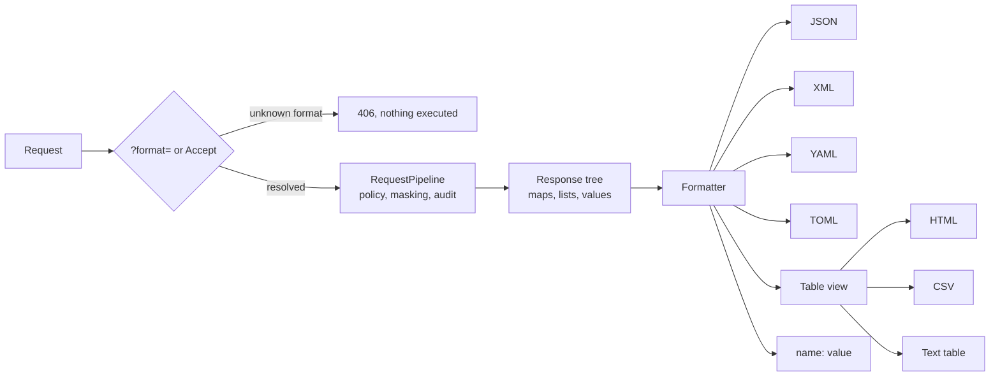

# 15 - Output formats

Every response of the REST API (`/api/v1`) can be delivered as JSON, XML, YAML, TOML, HTML, CSV,
plain text or as an aligned text table. Errors come in the same format as the answer would have.
The metrics endpoint has its own formats (Prometheus, OpenMetrics, InfluxDB, Graphite, StatsD,
OTLP); see [06 - Metrics](06-metrics.md#other-formats).

## How the format is chosen

1. The query parameter `format` - `json`, `xml`, `yaml`, `toml`, `html`, `csv`, `text`, `table`.
2. Otherwise the `Accept` header, with quality values. Wildcards (`*/*`) select JSON.
3. Otherwise JSON.

| `format` | `Accept` media types | Content type of the response |
|----------|----------------------|------------------------------|
| `json` | `application/json` | `application/json` |
| `xml` | `application/xml`, `text/xml` | `application/xml; charset=utf-8` |
| `yaml` | `application/yaml`, `application/x-yaml`, `text/yaml` | `application/yaml; charset=utf-8` |
| `toml` | `application/toml` | `application/toml; charset=utf-8` |
| `html` | `text/html`, `application/xhtml+xml` | `text/html; charset=utf-8` |
| `csv` | `text/csv` | `text/csv; charset=utf-8; header=present` |
| `text` | `text/plain` | `text/plain; charset=utf-8` |
| `table` | (only with `?format=table`) | `text/plain; charset=utf-8` |

A browser that opens an API URL sends `Accept: text/html,...` and therefore gets the HTML page.
`curl`, scripts and HTTP libraries send `*/*` or nothing and keep getting JSON, so existing
clients are not affected.

An unknown or disabled `format` is answered with `406` in JSON. **The format is checked before
anything else happens**: `POST /api/v1/exec?format=pdf` does not run the operation.

`api.formats` restricts the available formats; JSON is always available:

```yaml
api:
  formats: [json, yaml, csv]      # default: all eight
```

What stays JSON regardless of the format: the Jolokia endpoint (`/jolokia`, its protocol is
JSON), the payloads of SSE and WebSocket streams, and the audit log.



Formats only change the syntax. Masking and type conversion happen before, in the pipeline, so a
masked value is `********` in every format and large 64-bit numbers are strings everywhere.

## The formats

The examples use the same request with different formats.

### XML

```bash
curl -s -u rita "https://server:8443/rocoto/api/v1/mbeans/java.lang%3Atype%3DRuntime/attributes/VmName?format=xml"
```

```xml
<?xml version="1.0" encoding="UTF-8"?>
<response>
  <mbean>java.lang:type=Runtime</mbean>
  <attribute>VmName</attribute>
  <value>Java HotSpot(TM) 64-Bit Server VM</value>
</response>
```

- Map entries become elements; list elements are `<item>`.
- Keys that cannot be element names - ObjectNames, keys with blanks, keys starting with `xml` -
  become `<entry key="java.lang:type=Memory">`.
- Numbers and booleans carry `type="number"` / `type="boolean"`, lists `type="array"`, `null` is
  `nil="true"`.
- The document never contains a DOCTYPE or entities. Characters XML 1.0 cannot carry (most
  control characters) are replaced by U+FFFD.

### YAML

```bash
curl -s -u rita -H "Accept: application/yaml" \
  https://server:8443/rocoto/api/v1/mbeans/java.lang%3Atype%3DMemory/attributes/HeapMemoryUsage
```

```yaml
mbean: java.lang:type=Memory
attribute: HeapMemoryUsage
value:
  committed: 270532608
  init: 268435456
  max: 4294967296
  used: 59312672
```

Strings that YAML would read as numbers, booleans or null are quoted (`"42"`, `"true"`), so the
types survive a round trip. The OpenAPI document is also available as YAML:
`/api/v1/openapi.json?format=yaml`.

### TOML

```toml
mbean = "java.lang:type=Memory"
attribute = "HeapMemoryUsage"

[value]
committed = 270532608
init = 268435456
max = 4294967296
used = 71968608
```

Nested maps become tables, lists of maps arrays of tables (`[[items]]`), other lists inline
arrays. **TOML has no null**: entries whose value is `null` are left out. Integers beyond the 64-bit
range are written as strings.

### HTML

```bash
# in a browser: https://server:8443/rocoto/api/v1/resources/threadpools
curl -s -u rita "https://server:8443/rocoto/api/v1/resources/threadpools?format=html"
```

A complete page: the plain values of the response as a definition list, the tabular part (see
[Table view](#the-table-view)) as a table, nested values as nested tables and lists. The page
follows the system's light or dark mode and stays usable on small screens; wide tables scroll
sideways.

Error responses (status 400 and above) start with a highlighted banner such as
**404 Not Found** followed by the message; for the plain error body (`status` and `error`) the banner
is the whole page. The HTTP status of the response is the real one, never `200`.

Security of the HTML output:

- Every value is HTML-escaped. MBean values are data that third parties can influence (an
  application's own MBeans, log messages, user names); they are never interpreted as markup.
- The page contains no script and no inline style. The stylesheet is a separate resource,
  `GET /api/v1/style.css`, which needs authentication like every other URL.
- HTML responses are sent with
  `Content-Security-Policy: default-src 'none'; style-src 'self'; frame-ancestors 'none';
  base-uri 'none'; form-action 'none'` - no script could run even if one slipped in.
- Cross-site requests are still refused by the filter (see
  [11 - Security hardening](11-security-hardening.md)); a foreign page cannot embed or read the
  HTML output.

### CSV

```bash
curl -s -u rita "https://server:8443/rocoto/api/v1/mbeans?pattern=java.lang:type=GarbageCollector,*&format=csv"
```

```text
mbeans
"java.lang:name=G1 Concurrent GC,type=GarbageCollector"
"java.lang:name=G1 Old Generation,type=GarbageCollector"
"java.lang:name=G1 Young Generation,type=GarbageCollector"
```

- RFC 4180: a header line, `CRLF` line ends, fields with commas, quotes, line breaks or leading
  or trailing blanks are quoted.
- Only the [table view](#the-table-view) is written; plain values next to the table (such as
  `kind` and `server` of a resources response) are not part of the CSV.
- Lists of plain values in a cell are written comma-separated (`1, 9, 10`), other nested values
  as compact JSON.
- **Formula injection is neutralized**: a text cell that starts with `=`, `+`, `-`, `@`, a tab or
  a carriage return gets a leading `'`, so a spreadsheet shows it as text instead of evaluating it.
  Numbers are written as numbers.

### Text (`name: value`)

```bash
curl -s -u rita "https://server:8443/rocoto/api/v1/mbeans/java.lang%3Atype%3DMemory/attributes/HeapMemoryUsage?format=text"
```

```text
mbean: java.lang:type=Memory
attribute: HeapMemoryUsage
value.committed: 270532608
value.init: 268435456
value.max: 4294967296
value.used: 61409824
```

One line per value. Nested keys are joined with dots, list elements are written as `[0]`, keys
that are not simple names in brackets: `values["java.lang:type=Memory"].Verbose`. Line breaks
and control characters inside values are escaped, so every value stays on its line - convenient
for `grep`, `awk` and monitoring scripts.

### Table

```bash
curl -s -u rita "https://server:8443/rocoto/api/v1/mbeans/java.lang%3Atype%3DMemory/attributes?format=table"
```

```text
mbean: java.lang:type=Memory

┌────────────────────────────────┬───────────────────────┐
│ name                           │ value                 │
├────────────────────────────────┼───────────────────────┤
│ ObjectPendingFinalizationCount │ 0                     │
│ HeapMemoryUsage.committed      │ 270532608             │
│ HeapMemoryUsage.init           │ 268435456             │
│ HeapMemoryUsage.max            │ 4294967296            │
│ HeapMemoryUsage.used           │ 61480840              │
│ NonHeapMemoryUsage.committed   │ 21954560              │
│ NonHeapMemoryUsage.init        │ 7667712               │
│ NonHeapMemoryUsage.max         │ -1                    │
│ NonHeapMemoryUsage.used        │ 18414288              │
│ Verbose                        │ false                 │
│ ObjectName                     │ java.lang:type=Memory │
└────────────────────────────────┴───────────────────────┘
```

| Parameter | Effect |
|-----------|--------|
| `ascii=true` | `+`, `-` and `\|` instead of box-drawing characters, for terminals without UTF-8 |
| `width=N` | longest cell before it is shortened with `…` (default 60, at most 500) |

Columns that contain only numbers are right-aligned.

## The table view

HTML, CSV and the text table need rows and columns, but API responses are trees. Rocoto
recognizes the typical shapes:

| Response | Rows | Columns |
|----------|------|---------|
| one list of objects (`items` of `/resources/...`, `results` of `/bulk`) | one per element | the keys of the elements |
| one list of values (`mbeans` of a search) | one per value | one, named after the list |
| a pattern read (`values` maps ObjectNames to attribute maps) | one per MBean | `name` plus the attributes |
| a multi-attribute read (`values` maps attributes to values) | one per value; nested maps flattened, lists of plain values in one row | `name`, `value` |
| anything else (`/server`, `/health`, errors, ...) | one per value of the flattened response, lists of plain values in one row | `name`, `value` |

A list of plain values - `AllThreadIds` of `java.lang:type=Threading`, the roles of the caller -
stays in one row: comma-separated in the text table and in CSV, as one wrapping line in HTML. Only
the `text` format writes one line per element (`AllThreadIds[2]: 10`), which is what `grep` wants.

In the first four cases the plain values next to the list or map (`kind`, `server`, `pattern`,
`mbean`) are shown above the table (text table, HTML) or left out (CSV).

## Choosing a format

| Need | Format |
|------|--------|
| programs, other tools, anything that must be exact | `json` |
| configuration management, humans editing the result | `yaml` |
| systems that expect XML (ESB, XSLT, legacy monitoring) | `xml` |
| config-style output for TOML-based tooling | `toml` (no `null`) |
| a quick look in the browser | `html` |
| spreadsheets, reports, `import` into a database | `csv` |
| shell scripts, `grep`, monitoring checks | `text` |
| a terminal | `table` |

Next: [Guide overview](README.md)
